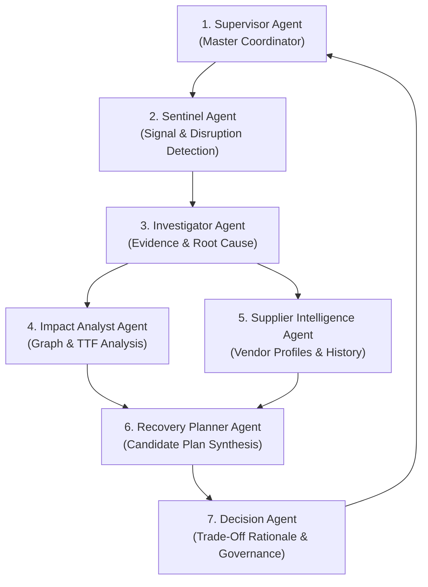

# Agent Architecture Specification - Roles, Boundaries & Tool Constraints

## 1. Agent Architecture Principles

In NEXUS, AI Agents act as **specialized reasoning sub-processors** operating within the overarching control engine. Agents perform hypothesis generation, unstructured context parsing, candidate plan drafting, and decision explanations.

### Strict Operational Boundaries
1. **No Direct Database Access**: Agents are strictly prohibited from issuing direct SQL, ORM, or database mutations.
2. **Tool-Mediated Interaction**: All data reading and state mutations must execute through explicit, permission-checked Tools.
3. **Structured Outputs**: All inter-agent communication and system outputs must conform to Pydantic JSON schemas.
4. **Deterministic Gateways**: Agent suggestions are passed to deterministic engines (Simulators, Optimizers, Policy Engines) before any execution occurs.

---

## 2. Comprehensive Agent Role Catalog (7 Agent Roles)



---

### 1. Supervisor Agent (Master Coordinator)
- **Primary Responsibility**: Manages the multi-agent execution lifecycle, delegates tasks to specialized sub-agents, tracks incident resolution context, and synthesizes final status reports.
- **Allowed Tool Categories**: `READ`, `ANALYSIS`
- **Input Schema**:
```json
{
  "incident_trigger_id": "INC-20260822-01",
  "raw_event_payload": { ... },
  "system_state_summary": { ... }
}
```
- **Output Schema**:
```json
{
  "investigation_plan": ["INV_STEP_1", "INV_STEP_2"],
  "assigned_agents": ["Investigator", "ImpactAnalyst"],
  "workflow_status": "INVESTIGATING"
}
```
- **Boundaries**: Does not directly generate recovery plans or perform simulation; relies strictly on sub-agent domain outputs.

---

### 2. Sentinel Agent (Signal & Disruption Monitor)
- **Primary Responsibility**: Scans ingested event feeds, telemetry streams, and domain adapter signals to detect disruptions, anomalies, and threshold breaches.
- **Allowed Tool Categories**: `READ`
- **Input Schema**:
```json
{
  "stream_segment": [ { "event_id": "EVT-101", ... } ],
  "monitoring_rules": [ { "rule_id": "RULE-THRESHOLD-01", ... } ]
}
```
- **Output Schema**:
```json
{
  "disruption_detected": true,
  "disruption_type": "SUPPLIER_SHIPMENT_DELAY",
  "affected_entity_id": "ENT-SUP-8821",
  "confidence": 0.98,
  "trigger_event_ids": ["EVT-101"]
}
```
- **Boundaries**: Cannot modify event streams or resolve evidence contradictions; flags disruptions for Investigation.

---

### 3. Investigator Agent (Evidence & Root Cause Analysis)
- **Primary Responsibility**: Correlates multi-source evidence, cross-checks conflicting signals (e.g., supplier updates vs. tracking telemetry), and identifies root causes.
- **Allowed Tool Categories**: `READ`, `ANALYSIS`
- **Input Schema**:
```json
{
  "disruption_id": "DIS-8812",
  "claimed_evidence": [ { "source": "SUPPLIER_EMAIL", "claim": "Dispatched" } ],
  "telemetry_evidence": [ { "source": "GPS_FEED", "claim": "No Movement" } ]
}
```
- **Output Schema**:
```json
{
  "root_cause_summary": "Supplier delayed dispatch due to sub-tier component shortage.",
  "evidence_contradictions_found": true,
  "reconciled_truth_confidence": 0.91,
  "verified_delay_hours": 72
}
```
- **Boundaries**: Strictly diagnostic; does not compute cascading impact or design recovery actions.

---

### 4. Impact Analyst Agent (Graph & TTF Analysis)
- **Primary Responsibility**: Queries the Dependency Graph to trace downstream propagation, component shortages, and computes Time-to-Failure (TTF) for active production lines.
- **Allowed Tool Categories**: `READ`, `ANALYSIS`
- **Input Schema**:
```json
{
  "verified_disruption": { "entity_id": "ENT-PO-7712", "delay_hours": 72 },
  "dependency_graph_depth": 5
}
```
- **Output Schema**:
```json
{
  "affected_production_orders": ["PROD-ORD-902", "PROD-ORD-905"],
  "breached_customer_orders": ["CUST-ORD-449"],
  "time_to_failure_hours": 38.5,
  "estimated_financial_exposure_usd": 125000.00
}
```
- **Boundaries**: Must invoke deterministic `calculate_time_to_failure` tools; forbidden from calculating TTF numbers directly in prompt context.

---

### 5. Supplier Intelligence Agent (Vendor Memory & Risk Profile)
- **Primary Responsibility**: Fetches supplier historical reliability, past lead-time variance, compliance ratings, and assesses alternative vendor viability.
- **Allowed Tool Categories**: `READ`, `ANALYSIS`
- **Input Schema**:
```json
{
  "supplier_id": "ENT-SUP-8821",
  "required_component_id": "RES-INV-10492"
}
```
- **Output Schema**:
```json
{
  "supplier_historical_reliability": 0.88,
  "past_incident_count": 4,
  "viable_alternative_suppliers": [
    { "supplier_id": "ENT-SUP-9910", "lead_time_days": 2, "unit_cost_premium": 0.15 }
  ]
}
```
- **Boundaries**: Read-only intelligence provider; cannot initiate supplier communications or modify contracts.

---

### 6. Recovery Planner Agent (Candidate Strategy Synthesizer)
- **Primary Responsibility**: Formulates structured candidate recovery strategies (e.g., split order, switch to air freight, substitute component, re-sequence production).
- **Allowed Tool Categories**: `READ`, `ANALYSIS`
- **Input Schema**:
```json
{
  "impact_summary": { ... },
  "supplier_intelligence": { ... },
  "policy_constraints": { ... }
}
```
- **Output Schema**:
```json
{
  "candidate_strategies": [
    {
      "strategy_id": "STRAT-ALT-SUPPLIER",
      "actions": [ { "action_type": "CREATE_PO", "target": "ENT-SUP-9910" } ],
      "rationale": "Procure backup stock from secondary supplier via express air freight."
    }
  ]
}
```
- **Boundaries**: Generates candidate plans only; must submit plans to the Scenario Simulator and Policy Engine for evaluation.

---

### 7. Decision Agent (Governance & Rationale Explainer)
- **Primary Responsibility**: Reviews multi-objective optimization results and policy evaluations, selects the optimal plan based on operator preferences, and generates human-readable decision briefings.
- **Allowed Tool Categories**: `READ`, `ANALYSIS`, `COMMUNICATION`
- **Input Schema**:
```json
{
  "simulated_scenarios": [ { "strategy_id": "STRAT-1", "score": 0.92, ... } ],
  "policy_compliance_report": { "status": "APPROVED" }
}
```
- **Output Schema**:
```json
{
  "recommended_strategy_id": "STRAT-ALT-SUPPLIER",
  "governance_status": "APPROVAL_REQUIRED",
  "operator_briefing": "Strategy 1 minimizes downtime to 0 hours with a $4,500 cost premium. Requires human authorization.",
  "escalation_target_role": "SUPPLY_CHAIN_DIRECTOR"
}
```
- **Boundaries**: Cannot bypass policy restrictions or auto-execute high-risk actions without Governance Engine sign-off.
