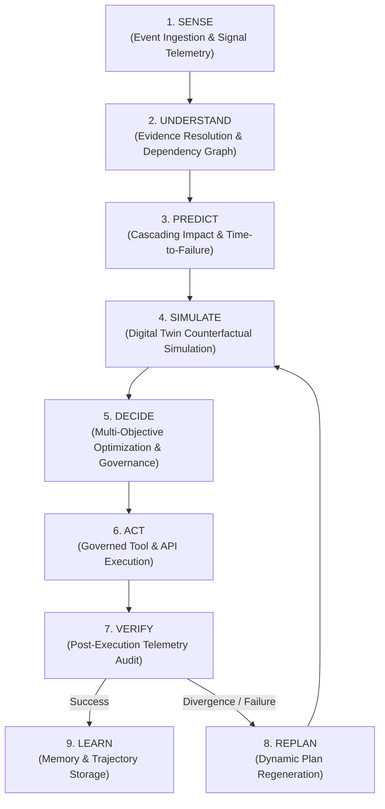
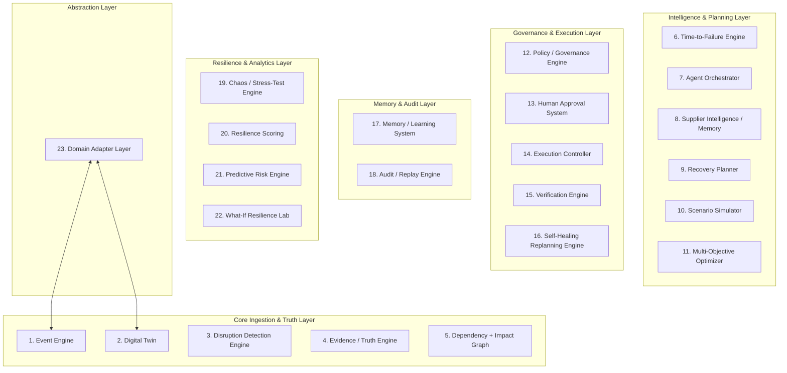

# System Architecture Specification - NEXUS Platform

## 1. Product Vision & Operational Context

**NEXUS** is an enterprise-grade **Autonomous Disruption Control Platform**. It provides closed-loop, governed operational resilience for complex supply chains, manufacturing ecosystems, and critical infrastructure. 

Unlike generic conversational AI tools, NEXUS operates as an **autonomous control system**. It combines high-level AI reasoning with strict deterministic operational execution. NEXUS systematically detects disruptions, investigates root causes, projects cascading impacts, simulates recovery scenarios, optimizes resolution plans, enforces governance policies, executes authorized actions, verifies post-action reality, replans dynamically when conditions change, and continuously learns from incident outcomes.

---

## 2. Primary NEXUS Control Loop

The platform operates on a continuous 9-stage closed-loop operational control architecture:



### Stage Description
1. **SENSE**: Continuous ingestion of raw operational signals, telemetry, ERP events, shipment tracking updates, and external feeds.
2. **UNDERSTAND**: Synthesizes conflicting evidence into verified operational truth, maps root causes, and binds events to dependency models.
3. **PREDICT**: Projects downstream propagation paths, inventory depletion curves, SLA default windows, and calculates Time-to-Failure (TTF).
4. **SIMULATE**: Runs reproducible, deterministic counterfactual simulations of candidate recovery actions on isolated Digital Twin forks.
5. **DECIDE**: Evaluates simulated outcomes against multi-objective functions (cost, lead time, risk, customer impact) under policy constraints.
6. **ACT**: Dispatches authorized recovery actions through deterministic tools, updating ERPs or sending communications subject to autonomy permissions.
7. **VERIFY**: Monitors real-world sensor/ERP updates to confirm whether the recovery action achieved the intended target state.
8. **REPLAN**: Triggers automatic dynamic replanning if verification detects divergence, unexpected delays, or new emerging disruptions.
9. **LEARN**: Persists anonymized incident trajectories, supplier performance vectors, and resolution strategies into long-term episodic memory.

---

## 3. System Component Catalog (23 Architecture Components)

NEXUS comprises 23 distinct system components structured across functional layers:



### Component Responsibilities & Relationships

1. **Event Engine**: Ingests, normalizes, deduplicates, and routes high-throughput operational event streams from external systems and domain adapters.
2. **Digital Twin**: Maintains real-time state representations (Current, Projected, Scenario) of physical and operational assets across the network.
3. **Disruption Detection Engine**: Monitors event streams against threshold models, statistical anomalies, and SLA parameters to flag active disruptions.
4. **Evidence / Truth Engine**: Reconciles ambiguous or conflicting data from multiple sources (e.g., supplier claims vs. GPS tracking vs. warehouse receiving) using confidence scoring.
5. **Dependency + Impact Graph**: Maintains a multi-tier directed acyclic dependency graph connecting entities, components, orders, and resources.
6. **Time-to-Failure (TTF) Engine**: Calculates exact temporal thresholds remaining before a disruption breaches operational SLAs, halts production lines, or causes stockouts.
7. **Agent Orchestrator**: Coordinates specialized AI agents, managing task delegation, memory context distribution, and workflow lifecycle.
8. **Supplier Intelligence / Memory**: Tracks historical supplier performance, lead-time variance, compliance ratings, and risk profiles.
9. **Recovery Planner**: Synthesizes structured candidate recovery strategies (e.g., re-routing, supplier substitution, expedited freight, priority shifting).
10. **Scenario Simulator**: Clones Digital Twin state representations to execute deterministic, counterfactual time-step simulations of recovery plans.
11. **Multi-Objective Optimizer**: Evaluates simulated candidate recovery plans against conflicting objectives (cost, time, risk, customer impact) using mathematical optimization algorithms.
12. **Policy / Governance Engine**: Enforces corporate rules, regulatory constraints, authorization budgets, and safety boundaries on proposed actions.
13. **Human Approval System**: Manages interactive approval workflows, escalation matrix routing, and operator sign-offs for high-risk actions.
14. **Execution Controller**: Safely dispatches approved action payloads to downstream operational systems via governed integration tools.
15. **Verification Engine**: Implements closed-loop monitoring following execution, comparing real-world system state telemetry against expected trajectory goals.
16. **Self-Healing Replanning Engine**: Automatically initiates re-investigation, re-simulation, and plan iteration if execution fails or new disruptions intervene.
17. **Memory / Learning System**: Captures full incident resolution trajectories to index vector memories, improving future planning and risk scoring.
18. **Audit / Replay Engine**: Maintains an immutable log of all events, evidence evaluations, agent thought processes, tool invocations, approvals, and outcomes for compliance and post-mortem replay.
19. **Chaos / Stress-Test Engine**: Injects synthetic disruptions (delays, stockouts, inaccurate reporting) to evaluate network resilience under simulated stress.
20. **Resilience Scoring**: Calculates continuous operational resilience metrics across suppliers, production sites, and logistical corridors.
21. **Predictive Risk Engine**: Uses historical trends and external indicator feeds to project forward-looking risk probabilities prior to active disruption events.
22. **What-If Resilience Lab**: Sandbox environment allowing operators to configure, test, and compare hypothetical supply chain structural changes.
23. **Domain Adapter Layer**: Standardizes domain-specific domain concepts (e.g., Manufacturing, Logistics, Aviation) into domain-agnostic NEXUS Core abstractions.

---

## 4. AI Reasoning vs. Deterministic Control Boundaries

NEXUS enforces a strict, unyielding division of responsibility between non-deterministic AI components and deterministic software engines.

| Functional Dimension | AI Reasoning (LLM / Agents) Responsibilities | Deterministic System Engine Responsibilities |
| :--- | :--- | :--- |
| **Unstructured Ingestion** | Extracting structured facts from unstructured emails, news, PDFs, and message feeds. | Parsing structured API payloads, JSON, SQL, and database event streams. |
| **Hypothesis Generation** | Proposing creative candidate recovery strategies and investigation directions. | Evaluating mathematical combinations, hard resource limits, and physical capacity constraints. |
| **Calculations & Math** | **STRICTLY PROHIBITED** from performing math. | Inventory coverage calculations, financial totals, time-to-failure (TTF), lead-time additions. |
| **Simulation & Projections** | Interpreting scenario trade-offs and drafting human-readable narrative summaries. | State propagation, inventory depletion step functions, discrete-event execution. |
| **Optimization & Choice** | Explaining trade-off choices to human operators. | Multi-objective scoring, Pareto frontier generation, linear/integer programming evaluation. |
| **Policy Validation** | Assisting in drafting policy rule suggestions. | **STRICTLY DETERMINISTIC** evaluation of rules, spending limits, SLA compliance, and regulatory gates. |
| **State Mutations** | Requesting tool invocations with validated schemas. | **STRICTLY DETERMINISTIC** database updates, tool execution, external API dispatches, state transitions. |
| **Auditing & Lineage** | Generating clear rationale descriptions for audit entries. | Cryptographic transaction hashing, immutable audit logging, timestamping, state diff storage. |

---

## 5. Domain Adapter Architecture Pattern

To prevent NEXUS Core from becoming bound to specific industry terminology, all external interfaces operate through standard **Domain Adapters**.

```
┌────────────────────────────────────────────────────────┐
│             NEXUS Core Engine (Domain Agnostic)        │
│  [Entity]  [Resource]  [Event]  [Constraint] [Action]  │
└───────────────────────────┬────────────────────────────┘
                            │ Universal Abstraction Interface
┌───────────────────────────┴────────────────────────────┐
│              Domain Adapter Interface (API)            │
└──────┬────────────────────┬────────────────────┬───────┘
       │                    │                    │
┌──────▼──────┐      ┌──────▼──────┐      ┌──────▼──────┐
│Manufacturing│      │  Logistics  │      │  Aviation   │
│   Adapter   │      │   Adapter   │      │   Adapter   │
└─────────────┘      └─────────────┘      └─────────────┘
```

1. **Core Abstraction Layer**: Consumes only `Entity`, `Resource`, `Event`, `Constraint`, `Action`, `Metric`, and `Dependency` generic models.
2. **Translation Layer**: Maps domain-specific schemas (e.g., SAP Purchase Orders, ISO Container Tracking) into Core primitives.
3. **Behavior Translation**: Converts core action decisions (e.g., `ACTION: REALLOCATE_RESOURCE`) into specific adapter function calls (e.g., `manufacturing.update_production_line_allocation()`).
