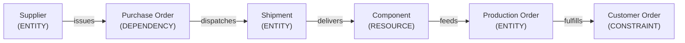

# Domain Model Specification - Core Abstractions & Manufacturing Adapter

## 1. Universal Domain-Agnostic Abstractions

NEXUS Core is engineered around seven universal operational primitives. The core reasoning engine, graph structures, simulation frameworks, and optimizers interact exclusively with these core abstractions.

```
                  ┌──────────────┐
                  │    ENTITY    │
                  └──────┬───────┘
                         │ 1..*
            ┌────────────┼────────────┐
            ▼            ▼            ▼
     ┌───────────┐ ┌───────────┐ ┌───────────┐
     │ RESOURCE  │ │   EVENT   │ │CONSTRAINT │
     └─────┬─────┘ └─────┬─────┘ └─────┬─────┘
           │             │             │
           └─────────────┼─────────────┘
                         ▼
                  ┌──────────────┐
                  │    ACTION    │
                  └──────┬───────┘
                         │
            ┌────────────┴────────────┐
            ▼                         ▼
     ┌───────────┐             ┌───────────┐
     │  METRIC   │             │DEPENDENCY │
     └───────────┘             └───────────┘
```

### 1. ENTITY
Represents a physical, organizational, or logical operational node in the system network.
- **Key Attributes**: `id`, `name`, `type`, `domain`, `status`, `attributes`, `metadata`
- **Schema Template**:
```json
{
  "entity_id": "ENT-SUP-8821",
  "name": "Acme Microelectronics Inc.",
  "entity_type": "SUPPLIER",
  "domain": "manufacturing",
  "status": "ACTIVE",
  "attributes": {
    "tier": 1,
    "location": "Taipei, TW",
    "reliability_score": 0.94
  }
}
```

### 2. RESOURCE
Represents consumable, allocatable, or capacity-constrained assets owned or processed by an Entity.
- **Key Attributes**: `id`, `entity_id`, `name`, `resource_type`, `capacity_total`, `capacity_available`, `unit_of_measure`
- **Schema Template**:
```json
{
  "resource_id": "RES-INV-10492",
  "entity_id": "ENT-WH-02",
  "name": "Microcontroller Unit MCU-v4",
  "resource_type": "INVENTORY",
  "capacity_total": 5000,
  "capacity_available": 1200,
  "unit_of_measure": "UNITS"
}
```

### 3. EVENT
Represents a state change, telemetry signal, incident, or external notification occurring at a specific point in time.
- **Key Attributes**: `id`, `source_id`, `event_type`, `timestamp`, `severity`, `payload`, `confidence`
- **Schema Template**:
```json
{
  "event_id": "EVT-20260822-0941",
  "source_id": "ENT-SUP-8821",
  "event_type": "SHIPMENT_DELAYED",
  "timestamp": "2026-08-22T09:41:00Z",
  "severity": "HIGH",
  "confidence": 0.95,
  "payload": {
    "shipment_id": "SHP-9902",
    "delay_hours": 72,
    "reason": "Port Congestion"
  }
}
```

### 4. CONSTRAINT
Represents hard operational limits, policies, SLAs, or boundary conditions that must not be violated.
- **Key Attributes**: `id`, `target_id`, `constraint_type`, `threshold_value`, `operator`, `is_hard_constraint`
- **Schema Template**:
```json
{
  "constraint_id": "CSTR-SLA-001",
  "target_id": "ENT-CUST-ORD-449",
  "constraint_type": "DELIVERY_DEADLINE",
  "threshold_value": "2026-08-28T17:00:00Z",
  "operator": "LESS_THAN_OR_EQUAL",
  "is_hard_constraint": true
}
```

### 5. ACTION
Represents an operational intervention, command, re-allocation, or recovery task capable of being executed.
- **Key Attributes**: `id`, `action_type`, `target_entity_id`, `parameters`, `estimated_cost`, `estimated_lead_time_hours`, `autonomy_level`
- **Schema Template**:
```json
{
  "action_id": "ACT-REC-3301",
  "action_type": "EXPEDITE_PURCHASE_ORDER",
  "target_entity_id": "ENT-PO-7712",
  "parameters": {
    "freight_mode": "AIR_EXPRESS",
    "additional_cost_usd": 4500.00
  },
  "estimated_cost": 4500.00,
  "estimated_lead_time_hours": 24,
  "autonomy_level": 2
}
```

### 6. METRIC
Represents quantitative measurements, key performance indicators (KPIs), or operational health scores.
- **Key Attributes**: `id`, `target_id`, `metric_name`, `value`, `unit`, `timestamp`
- **Schema Template**:
```json
{
  "metric_id": "MTR-TTF-009",
  "target_id": "ENT-PROD-LINE-01",
  "metric_name": "TIME_TO_FAILURE_HOURS",
  "value": 38.5,
  "unit": "HOURS",
  "timestamp": "2026-08-22T10:00:00Z"
}
```

### 7. DEPENDENCY
Represents directional relationships between entities, resources, and processes where target performance relies on source availability.
- **Key Attributes**: `id`, `source_entity_id`, `target_entity_id`, `dependency_type`, `criticality`, `lead_time_hours`
- **Schema Template**:
```json
{
  "dependency_id": "DEP-4019",
  "source_entity_id": "ENT-PO-7712",
  "target_entity_id": "ENT-PROD-ORD-902",
  "dependency_type": "REQUIRES_COMPONENT",
  "criticality": "CRITICAL",
  "lead_time_hours": 48
}
```

---

## 2. Manufacturing Domain Adapter Mapping

The primary hackathon domain is **Manufacturing / Supply Chain Operations**. All domain-specific terms map directly into the core primitives without modifying Core engine schemas.

| Manufacturing Domain Term | Core Universal Primitive | Domain Mapping Details |
| :--- | :--- | :--- |
| **Supplier** | `ENTITY` (`type: SUPPLIER`) | External vendor providing raw materials or components. |
| **Component** | `RESOURCE` (`type: INVENTORY`) | Part, raw material, or assembly required for production. |
| **Inventory** | `RESOURCE` (`type: CAPACITY`) | Stock levels across warehouses, hubs, or plants. |
| **Purchase Order (PO)** | `DEPENDENCY` / `ENTITY` | Commercial contract binding Supplier to Component delivery. |
| **Shipment** | `ENTITY` (`type: TRANSPORT`) | In-transit freight movement carrying components. |
| **Production Order** | `ENTITY` (`type: PROCESS`) | Factory assembly run requiring components and plant capacity. |
| **Customer Order** | `CONSTRAINT` (`SLA Deadline`) | End-customer contract specifying quantities and delivery dates. |
| **Policy** | `CONSTRAINT` (`type: GOVERNANCE`) | Internal rules governing spending limits, safety, or vendor selection. |

### Manufacturing Dependency Chain Hierarchy



#### Propagation Logic:
A delay at `Supplier` invalidates the delivery schedule of `Purchase Order`, delaying `Shipment` arrival, reducing available `Component` inventory at the factory, halting `Production Order` execution, and ultimately breaching `Customer Order` SLA constraints.

---

## 3. Future Domain Extensions (Domain Neutrality Validation)

To validate that NEXUS Core remains domain-agnostic, future adapters can be added seamlessly by mapping their specific concepts to core primitives:

### Extension Example 1: NEXUS Logistics / Fleet Operations
- **Vehicle / Aircraft**: `ENTITY` (`type: ASSET`)
- **Route / Corridor**: `DEPENDENCY` (`type: SPATIAL_PATH`)
- **Fuel / Battery**: `RESOURCE` (`type: ENERGY`)
- **Traffic / Weather Delay**: `EVENT` (`type: DISRUPTION`)
- **Reroute Vehicle**: `ACTION` (`type: REALLOCATE`)
- **On-Time Delivery SLA**: `CONSTRAINT` (`type: TEMPORAL`)

### Extension Example 2: NEXUS Energy Grid
- **Power Generation Plant**: `ENTITY` (`type: GENERATOR`)
- **Transmission Line**: `DEPENDENCY` (`type: FLOW_CAPACITY`)
- **Grid Voltage / Wattage**: `RESOURCE` (`type: CAPACITY`)
- **Generator Trip**: `EVENT` (`type: FAILURE`)
- **Shed Load / Reroute Grid**: `ACTION` (`type: GOVERNED_MUTATION`)
- **Frequency Stability SLA**: `CONSTRAINT` (`type: HARD_OPERATIONAL`)
