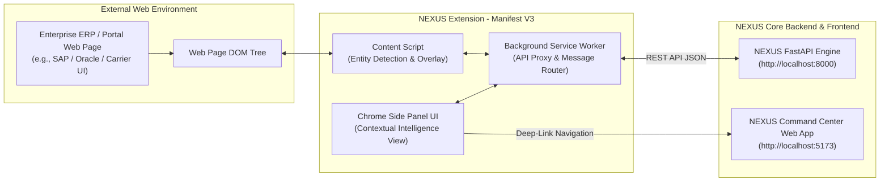

# NEXUS — BROWSER EXTENSION ARCHITECTURE AUDIT & DESIGN PROPOSAL
**Document Version**: 1.0.0  
**Status**: ARCHITECTURE PROPOSAL ONLY (Zero Code Mutations Performed)  
**Target Platform**: Google Chrome Manifest V3  
**Architecture Role**: Contextual Operational Intelligence Layer  

---

## 1. Architectural Fit

The proposed **NEXUS Browser Extension** acts as a lightweight, non-invasive **Contextual Operational Intelligence Layer**. It bridges external enterprise operational web portals (e.g., SAP, Oracle Cloud SCM, Workday, supplier portals, carrier tracking web apps) with the deterministic NEXUS core intelligence engine.



### Key Architectural Boundaries & Rules
1. **Domain-Agnostic Core Preservation**: The extension does NOT implement custom business logic, graph traversal, or risk scoring. 100% of operational intelligence originates from the existing NEXUS FastAPI backend (`/api/v1/intelligence/*`).
2. **Zero Database State Mutations**: The extension operates in **100% READ-ONLY / SIMULATION ONLY** mode. No `INSERT`, `UPDATE`, or `DELETE` operations are requested or executed.
3. **No Autonomous Operational Actions**: The extension contains **ZERO** action execution controls (`No Execute`, `No Approve`, `No Apply`, `No Commit`).
4. **Phase 0–2.5 Integrity**: Existing backend services, database schemas, migrations, seed data, and web frontend code remain completely untouched and frozen.

---

## 2. Extension Responsibilities

- **DOM Scanning & Entity Recognition**: Continuously scans active web page text for known NEXUS entity business codes (`SUP-001`, `PO-2026-001`, `SHP-2026-001`, `CMP-001`, `PRD-2026-001`, `SO-2026-001`, `ENTITY:*`, `RESOURCE:*`).
- **In-Page Contextual Badging**: Injects unobtrusive, isolated visual badges next to recognized business codes on external web pages without altering page styling.
- **Contextual Side Panel / Overlay UI**: Displays localized entity details, downstream dependency counts, active bottlenecks, baseline SLA financial exposure, and mitigation recommendations inside the Chrome Side Panel.
- **Explicit User-Triggered Actions**: Provides explicit user action buttons to execute:
  1. *Run Impact Analysis* (`POST /api/v1/intelligence/impact-analysis`)
  2. *Run Mitigation Simulation* (`POST /api/v1/intelligence/mitigations`)
- **Deep-Link Navigation**: Allows one-click transition from external portal entity context directly into the main NEXUS Web Command Center pages (`/impact-workspace`, `/graph-viewer`, `/mitigations`).

---

## 3. Backend Responsibilities

The existing NEXUS FastAPI backend retains exclusive responsibility for:
- **Operational Dependency Graph**: Constructing and querying the directed multi-tier graph (`get_or_build_operational_graph`).
- **Impact Propagation Analysis**: Calculating propagation depth, causal paths, production delays, stockouts, and dynamic SLA financial exposure (`analyze_impact`).
- **Mitigation & Simulation Engine**: Evaluating 5 candidate categories, calculating avoided exposure, mitigation costs, net values, enforcing single-source constraint rules (`SINGLE_SOURCE_RESTRICTION`), and generating machine-readable structured reasoning (`why_this`, `why_not`).
- **Bottleneck & Inventory Risk Detection**: Aggregating network-wide critical node vulnerabilities.

---

## 4. Data Flow

```
1. User navigates external ERP page (e.g. SAP order view displaying "SUP-001" & "SO-2026-001").
2. Content Script detects business code regex pattern "SUP-001" in DOM text nodes.
3. Content Script injects an isolated NEXUS Context Badge next to the text.
4. User clicks the NEXUS Context Badge or opens Chrome Side Panel.
5. Content Script sends message `FETCH_ENTITY_CONTEXT` to Background Service Worker.
6. Background Service Worker calls GET /api/v1/intelligence/graph/ENTITY/de52b8c0... on backend.
7. Backend returns node graph payload (business code, domain, status, attributes).
8. Side Panel renders localized entity health and active risk status.
9. User explicitly clicks "Run Impact Analysis".
10. Background Service Worker posts DisruptionInput to POST /api/v1/intelligence/impact-analysis.
11. Backend evaluates propagation graph and returns derived $200,000 exposure result.
12. Side Panel updates with SLA exposure summary and provides "Simulate Mitigations" button.
13. User explicitly clicks "Simulate Mitigations".
14. Background Service Worker posts request to POST /api/v1/intelligence/mitigations.
15. Backend evaluates candidates and returns Shipment Expedition (#1, $100k avoided, $87.5k net value).
16. Side Panel renders top recommendation, WHY THIS, and WHY NOT Supplier Substitution.
17. User clicks "Open in NEXUS Command Center" -> opens http://localhost:5173/mitigations in new tab.
```

---

## 5. Component Architecture

The extension will comprise 5 modular, un-bundled components built with TypeScript:

```
chrome-extension/
├── manifest.json                  # Manifest V3 Specification
├── src/
│   ├── background/
│   │   └── service_worker.ts      # API proxy, background state, chrome message router
│   ├── content/
│   │   ├── scanner.ts             # DOM text regex matcher & MutationObserver
│   │   └── badge_overlay.ts       # Shadow-DOM isolated status badge injector
│   ├── sidepanel/
│   │   ├── index.html             # Side Panel HTML root
│   │   ├── SidePanelApp.tsx       # React component rendering entity context & trade-offs
│   │   └── components/            # Reusable UI cards (ScoreBreakdown, RecommendationHero)
│   ├── popup/
│   │   ├── popup.html             # Quick extension status & connection check popup
│   │   └── popup.ts               # Health status indicator script
│   └── shared/
│      ├── api_client.ts          # Extension API client communicating with http://localhost:8000
│      ├── types.ts               # Shared TypeScript interfaces mirroring backend schemas
│      └── constants.ts            # Business code regex patterns & default server URL
```

---

## 6. Manifest V3 Architecture

The extension will adhere strictly to Chrome **Manifest V3** specifications:

```json
{
  "manifest_version": 3,
  "name": "NEXUS Contextual Operational Intelligence",
  "version": "1.0.0",
  "description": "Contextual disruption intelligence and recovery simulation layer for enterprise operational portals.",
  "permissions": [
    "activeTab",
    "sidePanel",
    "storage",
    "scripting"
  ],
  "host_permissions": [
    "http://localhost:8000/*",
    "http://127.0.0.1:8000/*",
    "http://localhost:5173/*",
    "http://localhost:5180/*"
  ],
  "background": {
    "service_worker": "dist/background/service_worker.js",
    "type": "module"
  },
  "content_scripts": [
    {
      "matches": ["<all_urls>"],
      "js": ["dist/content/scanner.js"],
      "run_at": "document_idle"
    }
  ],
  "side_panel": {
    "default_path": "dist/sidepanel/index.html"
  },
  "action": {
    "default_popup": "dist/popup/popup.html",
    "default_title": "NEXUS Operational Intelligence"
  },
  "content_security_policy": {
    "extension_pages": "script-src 'self'; object-src 'self';"
  }
}
```

---

## 7. Permission Model

| Permission | Purpose | Justification & Scope |
|---|---|---|
| `activeTab` | Grants temporary access to active tab upon user interaction. | Allows badge insertion on active ERP/Portal pages without broad web access. |
| `sidePanel` | Enables Chrome Side Panel API (`chrome.sidePanel.open`). | Displays side-by-side decision workspace alongside external portals. |
| `storage` | Stores user settings (e.g. custom NEXUS API endpoint URL). | Retains local config without backend session coupling. |
| `scripting` | Programmatically injects badge styling if required. | Limited strictly to active tab content injection. |
| `host_permissions` | Allows HTTP calls to backend (`http://localhost:8000/*`). | Enables REST API calls to existing NEXUS backend services. |

---

## 8. Entity Detection Strategy

### Business Code Pattern Matching Engine
The content script scans text nodes using regular expressions corresponding to the NEXUS Manufacturing Domain Adapter primitives:

```typescript
export const ENTITY_PATTERNS = {
  SUPPLIER: /\b(SUP-\d{3,6})\b/g,               // e.g., SUP-001
  PURCHASE_ORDER: /\b(PO-\d{4}-\d{3,6})\b/g,     // e.g., PO-2026-001
  SHIPMENT: /\b(SHP-\d{4}-\d{3,6})\b/g,          // e.g., SHP-2026-001
  COMPONENT: /\b(CMP-\d{3,6})\b/g,              // e.g., CMP-001
  PRODUCTION_ORDER: /\b(PRD-\d{4}-\d{3,6})\b/g, // e.g., PRD-2026-001
  CUSTOMER_ORDER: /\b(SO-\d{4}-\d{3,6})\b/g,    // e.g., SO-2026-001
  EXPLICIT_ENTITY_UUID: /\bENTITY:([a-f0-9\-]{36})\b/gi,
  EXPLICIT_RESOURCE_UUID: /\bRESOURCE:([a-f0-9\-]{36})\b/gi,
};
```

### DOM MutationObserver & Debouncing
- To support Single Page Applications (SPAs) like SAP Fiori or Oracle Cloud without causing performance degradation, the content script utilizes a debounced `MutationObserver` (250ms interval) to scan dynamically loaded DOM nodes.
- Injected badges are isolated inside **Shadow DOM containers** to prevent style leakage into or out of external portal host pages.

---

## 9. API Integration Strategy

The extension communicates with the existing NEXUS FastAPI backend using `fetch` calls dispatched from the Background Service Worker:

1. **Health Verification**: `GET /api/v1/health`
2. **Node Subgraph Lookup**: `GET /api/v1/intelligence/graph/{node_type}/{node_id}`
3. **Node Dependencies**: `GET /api/v1/intelligence/dependencies/{node_type}/{node_id}`
4. **Network Bottlenecks**: `GET /api/v1/intelligence/bottlenecks`
5. **Deterministic Impact Analysis**: `POST /api/v1/intelligence/impact-analysis`
6. **Deterministic Mitigation Simulation**: `POST /api/v1/intelligence/mitigations`

### Mapping Table: Extension UI to Backend API

| Extension UI Component | Trigger Event | Backend API Route Called | Schema Returned |
|---|---|---|---|
| **Health Status Indicator** | Extension Load / Popup Open | `GET /api/v1/health` | `HealthResponse` |
| **Context Badge Lookup** | Entity Badge Click | `GET /api/v1/intelligence/graph/{type}/{id}` | `NodeGraphResponse` |
| **Side Panel Overview** | Panel Mount | `GET /api/v1/intelligence/dependencies/{type}/{id}` | `NodeDependenciesResponse` |
| **Run Impact Button** | Explicit User Click | `POST /api/v1/intelligence/impact-analysis` | `ImpactAnalysisResult` |
| **Run Simulation Button** | Explicit User Click | `POST /api/v1/intelligence/mitigations` | `MitigationSimulationResponse` |

---

## 10. Security Model

- **Read-Only Guarantee**: The extension issues only `GET` requests for data retrieval and `POST` requests for stateless simulation payloads. No state-mutating HTTP methods (`PUT`, `PATCH`, `DELETE`) exist in the API layer.
- **CORS Configuration**: The backend FastAPI server (`app.main`) configures `CORSMiddleware` allowing request origins from Chrome Extension schemas (`chrome-extension://*`) during development.
- **Shadow DOM Isolation**: Injected contextual overlays and badges are rendered inside closed Shadow DOM roots (`element.attachShadow({ mode: 'closed' })`), ensuring script or CSS injection vulnerabilities cannot compromise external enterprise host pages.
- **Zero Credentials Storage**: The extension stores no API keys, authorization tokens, or passwords in local browser storage.

---

## 11. Privacy Model

- **Zero Web Page Scraping**: The content script performs tokenized regex string matching only. Page text, DOM structure, forms, inputs, and user credentials are **NEVER** stored, transmitted, or logged.
- **No Analytics / Telemetry Exfiltration**: The extension collects zero user analytics, telemetry, or tracking metrics.
- **Local Host Scoping**: By default, backend network traffic is bound exclusively to local development servers (`http://localhost:8000`).

---

## 12. Failure Handling & Resilience

- **Backend Offline / 503 Degraded**: The extension displays a clear alert badge ("NEXUS Backend Offline (503)") with a manual "Retry Connection" CTA. No fallback mock intelligence is fabricated.
- **Entity 404 Not Found**: If a detected business code (e.g. `SUP-999`) does not exist in the NEXUS operational graph, the side panel displays: `"Entity 'SUP-999' not indexed in NEXUS Dependency Graph."`
- **Request Timeout / Network Drop**: Requests set a strict 10-second timeout. Timeouts trigger a non-blocking error toast without freezing the Chrome Side Panel or crashing content scripts.
- **Double-Submit Guard**: Submit buttons in the extension UI enter a `disabled` state with a spinning indicator during pending async API calls to prevent duplicate POST requests.

---

## 13. Deep-Link Strategy

The extension provides seamless 1-click deep links from the Chrome Side Panel directly into the main NEXUS Web Command Center pages:

```typescript
export const buildDeepLink = (
  targetPage: 'impact' | 'mitigations' | 'graph',
  params: { target_id?: string; event_type?: string; preset?: string }
): string => {
  const baseUrl = 'http://localhost:5173';
  const query = new URLSearchParams(params as Record<string, string>).toString();

  switch (targetPage) {
    case 'impact':
      return `${baseUrl}/impact-workspace?${query}`;
    case 'mitigations':
      return `${baseUrl}/mitigations?${query}`;
    case 'graph':
      return `${baseUrl}/graph-viewer?${query}`;
    default:
      return baseUrl;
  }
};
```

---

## 14. Development & Build Strategy

- **Build Pipeline**: Built using Vite in multi-page/extension build mode (`vite build --config vite.config.ext.ts`). Outputs bundled JavaScript and HTML into a clean root `/dist` directory.
- **Developer Loading**: Loaded into Google Chrome via `chrome://extensions` ➔ "Load unpacked" ➔ select `d:\Nexus\extension\dist` directory.
- **Hot Reloading**: Vite extension plugin handles automatic background script reloads during development.

---

## 15. Testing Strategy

1. **Unit Testing (Vitest)**:
   - Regex Entity Parser unit tests (`scanner.test.ts` verifying extraction of `SUP-001`, `SO-2026-001`, etc.).
   - Chrome Extension Message Router unit tests (`service_worker.test.ts`).
2. **Integration Testing**:
   - Mock API integration tests validating payload compatibility against backend FastAPI Pydantic models.
3. **E2E Browser Testing**:
   - Automated Playwright/Vitest browser test opening a sample HTML enterprise page, verifying badge injection, clicking badge, opening side panel, and verifying `$200,000.00` exposure & Shipment Expedition recommendation.

---

## 16. Hackathon Demo Strategy

The hackathon live demo flow demonstrates contextual disruption control over an external operational portal:

```
1. Open a simulated SAP / Oracle ERP web page containing purchase order details for SUP-001 and SO-2026-001.
2. Highlight the automatically injected "NEXUS Context Badge" next to SUP-001.
3. Click the badge to launch the NEXUS Chrome Side Panel.
4. View the localized entity health, downstream customer order risk (Titan Motors), and active bottleneck status.
5. Click "Run Impact Analysis" -> Observe derived $200,000.00 baseline SLA exposure and 4.0-day delivery delay.
6. Click "Simulate Mitigations" -> Observe Shipment Expedition recommended as #1 ($100k avoided, $87.5k net value).
7. Observe Supplier Substitution marked UNAVAILABLE due to CMP-001 SINGLE_SOURCE_RESTRICTION.
8. Click "Open in NEXUS Command Center" -> Instantly transition into the main web application at http://localhost:5173/mitigations.
```

---

## 17. Architecture Risks & Mitigation Matrix

| Risk Factor | Impact Level | Mitigation Strategy |
|---|---|---|
| **External Portal DOM Refactoring** | Moderate | Use class/id agnostic text node scanning with debounced `MutationObserver`. |
| **MV3 Service Worker Idle Termination** | Low | Store active scenario state in `chrome.storage.local`; re-hydrate on wakeup. |
| **CORS Policy Restrictions** | Low | FastAPI backend includes explicit `CORSMiddleware` permitting Chrome Extension origin schemes. |
| **Style Bleed into Host Pages** | Low | Render all injected content inside isolated Shadow DOM roots. |
| **Performance Overhead on Large DOMs** | Low | Throttle DOM scanning to 250ms intervals; limit text node inspection depth. |

---

## 18. Recommended Implementation Roadmap

1. **Phase 1: Manifest V3 & Extension Shell Setup**
   - Create `extension/manifest.json`, TypeScript build configuration, and empty service worker shell.
2. **Phase 2: Entity Detection Engine & Content Script**
   - Implement regex pattern parser (`scanner.ts`) and Shadow DOM badge overlay (`badge_overlay.ts`).
3. **Phase 3: Service Worker API Proxy Layer**
   - Implement message router (`service_worker.ts`) and REST API client (`api_client.ts`) communicating with `http://localhost:8000`.
4. **Phase 4: Side Panel Decision Workspace UI**
   - Build React Side Panel components (`SidePanelApp.tsx`, `RecommendationCard.tsx`, `ComparisonMatrix.tsx`).
5. **Phase 5: E2E Verification & Hardening**
   - Execute complete browser E2E demo flow against backend and verify zero operational state mutations.

---

NEXUS EXTENSION ARCHITECTURE AUDIT COMPLETE
