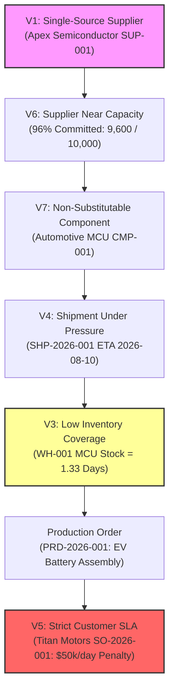

# Phase 2.2 Specification — Realistic Manufacturing Dataset & Vulnerability Scenario Plan (Revision 2)

## 1. Executive Summary & Dataset Objectives

Phase 2.2 defines the blueprint for a **deterministic, realistic synthetic operational dataset** representing an enterprise manufacturing and global supply chain network. The dataset provides the physical data substrate required for future vulnerability analysis, signal ingestion, digital twin simulation, and autonomous disruption control.

### Primary Objectives
1. **Deterministic Reproducibility**: Ensure 100% reproducible generation across environments via a fixed random seed (`SEED = 42`), deterministic namespace UUID generation (`uuid.uuid5`), and fixed relative dates from a baseline (`2026-08-01`).
2. **Ground Truth Boundary**: Seed strictly **ground truth operational inputs** (inventory balances, daily demand rates, PO dates, committed lead times, SLA penalty rates). Exclude all derived metrics (inventory coverage, stockout timestamps, time-to-failure, SLA financial exposure), leaving them to be dynamically calculated by future simulation and optimization engines.
3. **Seven Intentional Vulnerabilities**: Embed 7 structural vulnerability patterns (V1–V7) with an explicit, multi-node **vulnerability intersection chain** linking supplier risks to customer SLA contracts.
4. **Five Disruption Scenario Ground Truths**: Provide ground-truth initial parameters for 5 simulation scenarios (Scenarios A–E) while explicitly separating ground-truth inputs from calculated validation targets.

---

## 2. Target Entity Count Strategy

The dataset targets the following exact record counts:

| Table / Entity | Target Count | Primary Keys / Code Strategy | Description / Domain Role |
| :--- | :---: | :--- | :--- |
| **Suppliers** | **12** | `SUP-001` .. `SUP-012` | Tier-1 & Tier-2 semiconductor, battery, casing, and harness suppliers. |
| **Components** | **36** | `CMP-001` .. `CMP-036` | MCUs, PCBAs, Lithium cells, aluminum housings, wire harnesses, sensors. |
| **Warehouses** | **5** | `WH-001` .. `WH-005` | 2 Manufacturing Plants, 2 Regional DCs, 1 Central Buffer WH. |
| **Purchase Orders** | **75** | `PO-2026-001` .. `PO-2026-075` | Operational procurement orders across active suppliers. |
| **Purchase Order Items** | **150** | Item UUIDs | Individual line items specifying component quantities and prices. |
| **Shipments** | **60** | `SHP-2026-001` .. `SHP-2026-060` | In-transit and delivered freight shipments with carrier tracking numbers. |
| **Inventory Positions** | **120** | `(warehouse_id, component_id)` | Stock balances across warehouses with reserved stock and daily demand. |
| **Production Orders** | **40** | `PRD-2026-001` .. `PRD-2026-040` | Assembly runs for final products (`PRD-EV-BATT`, `PRD-INVERTER`). |
| **Production Order Items** | **160** | Item UUIDs | Component requirements and daily burn rates for each production run. |
| **Customer Orders** | **100** | `SO-2026-001` .. `SO-2026-100` | Sales orders for OEMs and enterprise customers. |
| **Customer Order Items** | **180** | Item UUIDs | Line items specifying required products and agreed prices. |
| **Customer Order Allocations** | **120** | Join Table UUIDs | Many-to-many allocations mapping customer order items to production orders. |
| **Supplier Performance** | **144** | `(supplier_id, eval_date)` | 12 monthly performance snapshots per supplier over the past year. |
| **Core Primitives** | **333** | Core UUIDs | Corresponding `Entity` (297) and `Resource` (36) primitive records. |
| **Dependencies** | **280** | Core Dependency UUIDs | Polymorphic dependency graph edges (`ENTITY`, `RESOURCE`, etc.). |

---

## 3. Ground Truth vs. Derived Operational Metrics

To preserve architectural purity (ADR-008 and deterministic simulation principles), the dataset strictly distinguishes seeded ground-truth facts from calculated operational metrics:

```
┌──────────────────────────────────────────────────────────┐
│              SEEDED GROUND TRUTH INPUTS                  │
│  (Persisted in DB by Phase 2.2 Seed Generator)           │
├──────────────────────────────────────────────────────────┤
│ • Physical stock balance (quantity_on_hand)              │
│ • Reserved allocation (quantity_reserved)                │
│ • Daily demand rate (average_daily_demand)               │
│ • Supplier capacity (monthly_capacity_units)             │
│ • Committed allocation (allocated_capacity_units)        │
│ • Purchase order quantities & agreed delivery dates      │
│ • In-transit shipment tracking, carrier, & ETA           │
│ • Production order line, product code, & start date      │
│ • Production item BOM quantity_required & burn rate      │
│ • Customer order delivery deadline & SLA penalty rate    │
│ • Explicit primitive dependency graph edges              │
└────────────────────────────┬─────────────────────────────┘
                             │
                             ▼
┌──────────────────────────────────────────────────────────┐
│             DYNAMICALLY DERIVED / SIMULATED              │
│  (Calculated on-the-fly by Phase 3+ Engines)             │
├──────────────────────────────────────────────────────────┤
│ • Available inventory (on_hand - reserved)               │
│ • Inventory buffer coverage (on_hand / daily_demand)     │
│ • Time-to-stockout timestamp                             │
│ • Supplier capacity utilization %                        │
│ • Disruption propagation impact path                     │
│ • Production line stoppage duration                      │
│ • Customer SLA breach probability & penalty cost         │
│ • Recommended optimal recovery actions & costs           │
└──────────────────────────────────────────────────────────┘
```

---

## 4. Component & Supplier Archetypes & Clarifications

### 4.1 Supplier Archetypes & V6 Clarification
Each supplier is assigned a deterministic archetype governing its capacity, reliability score, defect rate, and lead time:

| ID | Name | Archetype | Country | Reliability | Monthly Cap | Allocated Cap | Role & Vulnerability Clarification |
| :--- | :--- | :--- | :---: | :---: | :---: | :---: | :--- |
| `SUP-001` | Apex Semiconductor | **Single-Source / Near-Cap** | TWN | 0.98 | 10,000 | 9,600 | **V1 + Primary V6**: Sole MCU supplier running at 96% cap. Bottleneck in the primary vulnerability chain. |
| `SUP-002` | Global Logistics | **High-Capacity Reliable** | DEU | 0.96 | 50,000 | 25,000 | Primary casing & structural component supplier. |
| `SUP-003` | Budget Micro | **Unreliable / Quality-Risk** | CHN | 0.68 | 30,000 | 18,000 | **V2**: Low cost, high delay variance (average +7 days delay). |
| `SUP-004` | VoltTech Energy | **Near-Capacity (Secondary)** | KOR | 0.92 | 15,000 | 14,400 | **Secondary V6**: Lithium cell manufacturer running at 96% cap. Used specifically for Scenario D capacity reduction. |
| `SUP-005` | Precision Harnesses | **Reliable Tier-1** | MEX | 0.97 | 20,000 | 11,000 | High on-time delivery rate, dual-sourced components. |
| `SUP-006` | Alpha Sensors | **Quality-Risk** | USA | 0.82 | 12,000 | 7,500 | 8.5% defect rate (quality risk profile). |
| `SUP-007` | EuroCast Foundry | **Reliable High-Cost** | DEU | 0.99 | 8,000 | 4,200 | Premium aluminum castings. |
| `SUP-008` | SinoPCB Assembly | **High-Capacity Low-Cost** | CHN | 0.85 | 45,000 | 30,000 | Standard PCB assemblies. |
| `SUP-009` | Nippon Capacitor | **Reliable Single-Source** | JPN | 0.99 | 18,000 | 12,000 | **V7 (Secondary)**: Sole supplier for inverter capacitors (`CMP-009`). Independent graph vulnerability. |
| `SUP-010` | Andes Metalworks | **Unreliable Near-Cap** | CHL | 0.71 | 10,000 | 9,200 | Raw copper busbars, high lead time variance. |
| `SUP-011` | Nordic Thermal | **Reliable Tier-1** | SWE | 0.95 | 14,000 | 8,000 | Cooling plates for battery modules. |
| `SUP-012` | Vietnam Optronics | **Emerging Low-Cost** | VNM | 0.79 | 25,000 | 15,000 | Optical sensors and display glass. |

*Clarification on V6 Near-Capacity Suppliers*:
- `SUP-001` (96% cap utilization) is the **Primary Bottleneck** directly tied to single-sourced MCU `CMP-001` in the primary intersection chain. Any surge in demand for Plant 1 cannot be absorbed.
- `SUP-004` (96% cap utilization) is an **Independent High-Volume Bottleneck** supplying lithium cells (`CMP-004`). It provides the ground truth for Scenario D where cell supply is curtailed by 40%.

### 4.2 Primary vs. Secondary Critical Components
- **Primary Vulnerability-Chain Component (`CMP-001`)**: Automotive 32-bit MCU supplied exclusively by `SUP-001`. Drives the primary multi-node intersection chain (V1 $\to$ V6 $\to$ V7 $\to$ V4 $\to$ V3 $\to$ Production $\to$ V5).
- **Secondary Critical Component (`CMP-009`)**: High-Voltage Inverter Capacitor supplied exclusively by `SUP-009`. It is a single-sourced, non-substitutable component for inverter production (`WH-002`), establishing an independent secondary graph bottleneck for multi-path vulnerability discovery tests.

---

## 5. Operations & Production Consumption Model

### 5.1 Deterministic Production Consumption Inputs
Seed data specifies physical material requirements and daily burn rates on production order items, rather than hardcoding stockout timestamps:

- **Production Order `PRD-2026-001` Ground Truth**:
  - `warehouse_id`: `WH-001` (Plant 1 Munich).
  - `production_line_code`: `LINE-SMT-01`.
  - `product_code`: `PRD-EV-BATT`.
  - `start_date`: `2026-08-05`.
  - `target_completion_date`: `2026-08-15` (10-day run).
  - `quantity_to_produce`: `500.0000` units.
- **Production Item Requirement (`CMP-001` MCU)**:
  - `quantity_required`: `500.0000` units.
  - `quantity_issued`: `0.0000` units (awaiting inbound shipment `SHP-2026-001`).
  - `daily_burn_rate` (attributes JSON): `50.0000` units/day.

### 5.2 Dynamic Simulation Calculation Flow
Future Digital Twin simulation uses these seeded ground-truth inputs to dynamically derive:
$$\text{Available Stock} = \text{quantity\_on\_hand} (800) - \text{quantity\_reserved} (600) = 200 \text{ units}$$
$$\text{Time-to-Stockout} = \frac{\text{Available Stock} (200)}{\text{average\_daily_demand} (150)} = 1.33 \text{ days}$$
$$\text{Line Interruption Timestamp} = \text{Start Date} (2026\text{-}08\text{-}05) + 1.33 \text{ days} = 2026\text{-}08\text{-}06T08:00:00Z$$

> [!NOTE]
> **Simulation Validation Target Guardrail**: Derived timestamps (e.g., Stockout = `2026-08-06`) and financial impacts are benchmark validation targets. The seed generator MUST NOT insert stockout dates or derived penalties into database tables. The future simulation engine will independently arrive at these exact values from ground-truth inputs.

---

## 6. Seven Intentional Vulnerabilities & Intersection Map

### 6.1 Vulnerability Definitions
1. **V1 — Single-Source Critical Component**: `CMP-001` (32-bit MCU) is exclusively supplied by `SUP-001`.
2. **V2 — Unreliable Supplier**: `SUP-003` has a 0.68 reliability score and high delivery delay variance (+7 days).
3. **V3 — Low Inventory Coverage**: Ground-truth parameters: `on_hand=800`, `reserved=600`, `average_daily_demand=150`. These parameters are expected to produce approximately 1.33 days of available-inventory coverage when evaluated by the simulation engine.
4. **V4 — Shipment Under Deadline Pressure**: Shipment `SHP-2026-001` carrying 5,000 units of `CMP-001` is `IN_TRANSIT` with ETA `2026-08-10`.
5. **V5 — Strict High-Value Customer SLA**: Customer Order `SO-2026-001` ($2.5M order value, Titan Motors) has `requested_delivery_date = 2026-08-18` and SLA liquidated damages of `$50,000/day`.
6. **V6 — Supplier Near Capacity**: `SUP-001` has `monthly_capacity_units = 10,000` and `allocated_capacity_units = 9,600` (96% utilization).
7. **V7 — Non-Substitutable Critical Component**: `CMP-001` has no pin-compatible alternative in the component catalog.

### 6.2 Vulnerability Intersection Chain (Diagram)



---

## 7. Five Disruption Simulation Scenarios: Ground Truth vs. Validation Targets

For each scenario, initial parameters seeded in the DB are explicitly separated from expected simulation targets:

| Scenario ID | Name & Ground-Truth Trigger Parameters | Primary Affected Ground-Truth Entities | Expected Derived Simulation Validation Target |
| :--- | :--- | :--- | :--- |
| **Scenario A** | **72-Hour Port Strike at Rotterdam**: `SHP-2026-001` transit delay event (+72 hrs, ETA moves from `2026-08-10` to `2026-08-13`). | `SHP-2026-001`, `WH-003`, `WH-001` | *Calculated Target*: Plant 1 MCU stockout on Aug 6 $\to$ `PRD-2026-001` delayed 4 days $\to$ `SO-2026-001` delivered Aug 22 $\to$ **$200,000 late SLA penalty** (4 days @ $50k/day). |
| **Scenario B** | **Supplier Factory Outage (SUP-001)**: Event `EVT-OUTAGE-01` halts `SUP-001` production for 14 days starting `2026-08-02`. | `SUP-001`, `CMP-001`, `PO-2026-001` | *Calculated Target*: Global MCU stock exhausted across all plants within 5 days $\to$ **$1.8M unfulfilled revenue exposure** across 6 production orders. |
| **Scenario C** | **Demand Surge (+50% Volume)**: New Customer Order `SO-2026-101` requesting 250 units of `PRD-EV-BATT`. | `SO-2026-101`, `WH-001`, `CMP-004` | *Calculated Target*: Instant reservation surge $\to$ Lithium cell `CMP-004` stockout $\to$ 4 downstream customer orders delayed 6–12 days. |
| **Scenario D** | **Supplier Capacity Reduction (-40%)**: `SUP-004` `monthly_capacity_units` drops from 15,000 to 9,000. | `SUP-004`, `CMP-004` | *Calculated Target*: PO allocation rejection $\to$ Cell shortage at `WH-001` & `WH-002` $\to$ Production capacity capped at 60%. |
| **Scenario E** | **Production Line Failure**: Event `EVT-LINE-FAIL` breaks Plant 1 SMT line for 5 days. | `WH-001`, `LINE-SMT-01` | *Calculated Target*: `PRD-2026-001` completion delayed 5 days $\to$ **$250,000 SLA penalty** on `SO-2026-001`. |

---

## 8. Seed Generator Architecture & Manifest Determinism

### 8.1 Seed Generator Script Layout (`backend/scripts/seed/`)

```
backend/scripts/seed/
├── __init__.py
├── constants.py            # Fixed SEED = 42, NAMESPACE_NEXUS, BASELINE_DATE = 2026-08-01
├── seed_primitives.py       # Core Entity & Resource generators
├── seed_suppliers.py        # 12 Supplier profiles + Core mappings
├── seed_components.py       # 36 Component records + Core mappings
├── seed_warehouses.py       # 5 Warehouse facilities + Core mappings
├── seed_inventory.py        # 120 Inventory positions
├── seed_procurement.py      # 75 Purchase Orders + 150 PO Items
├── seed_shipments.py        # 60 Shipments
├── seed_production.py       # 40 Production Orders + 160 Production Items
├── seed_customer_orders.py  # 100 Customer Orders + 180 Order Items
├── seed_allocations.py      # 120 Customer-Production allocations
├── seed_dependencies.py     # 280 Polymorphic graph edges
├── seed_performance.py      # 144 Monthly supplier performance records
└── run_seed.py              # Execution entrypoint with transactional rollback on error
```

### 8.2 Deterministic Identifiers & Dates
- **Fixed Seed**: `SEED = 42`.
- **UUID Determinism**: All primary keys are generated using `uuid.uuid5(NAMESPACE_NEXUS, f"{entity_type}:{business_code}")`.
- **Date Determinism**: All timestamps are calculated relative to `BASELINE_DATE = date(2026, 8, 1)`.

### 8.3 Machine-Readable Manifest (`dataset_manifest.json`)
The dataset manifest excludes runtime-generated metadata from its SHA-256 checksum calculation:

```json
{
  "dataset_version": "1.0.0",
  "random_seed": 42,
  "namespace": "a3b4c5d6-e7f8-4901-8234-56789abcdef0",
  "baseline_date": "2026-08-01",
  "dataset_checksum": "e3b0c44298fc1c149afbf4c8996fb92427ae41e4649b934ca495991b7852b855",
  "record_counts": {
    "suppliers": 12,
    "components": 36,
    "warehouses": 5,
    "inventory_positions": 120,
    "purchase_orders": 75,
    "purchase_order_items": 150,
    "shipments": 60,
    "production_orders": 40,
    "production_order_items": 160,
    "customer_orders": 100,
    "customer_order_items": 180,
    "customer_order_allocations": 120,
    "supplier_performance": 144,
    "core_entities": 297,
    "core_resources": 36,
    "core_dependencies": 280
  },
  "vulnerability_identifiers": {
    "v1_supplier_code": "SUP-001",
    "v1_component_part": "CMP-001",
    "v3_warehouse_code": "WH-001",
    "v4_shipment_tracking": "SHP-2026-001",
    "v5_customer_order_number": "SO-2026-001"
  },
  "metadata_informational_only": {
    "generated_at": "2026-08-22T12:00:00Z",
    "note": "generated_at is informational and explicitly excluded from dataset_checksum calculation"
  }
}
```

---

## 9. Data Quality Rules & Validation Requirements

Before committing generated records, the seed script enforces strict operational data quality checks:

1. **Foreign Key Integrity**: Zero orphan foreign keys across adapter and core tables.
2. **Polymorphic Dependency Boundary**: `validate_polymorphic_dependency()` passes for all 280 dependency edges, and zero `DEPENDENCY` endpoints exist.
3. **Production Material Requirements Feasibility**: All production items reference existing components in the component catalog.
4. **Customer Allocation Bounds**: For every production order, $\sum \text{allocated\_quantity} \le \text{quantity\_to\_produce}$.
5. **Shipment Quantity Bounds**: For every purchase order line item, $\sum \text{shipped\_quantity} \le \text{quantity\_ordered}$.
6. **Supplier Capacity Bounds**: For every supplier, $\sum \text{active\_po\_quantity} = \text{allocated\_capacity\_units} \le \text{monthly\_capacity\_units}$.
7. **Inventory Invariant**: `quantity_reserved <= quantity_on_hand` across all 120 inventory positions.
8. **Date Hierarchy Validation**:
   - PO: `expected_delivery_date >= order_date`
   - Customer Order: `requested_delivery_date >= order_date`
   - Production Order: `target_completion_date >= start_date`

---

## 10. Automated Testing Strategy for Deterministic Regeneration

In Phase 2.2 implementation, automated pytest scripts will verify:
1. **Deterministic Regeneration Test**: Running `run_seed.py` on two fresh PostgreSQL databases with `SEED=42` produces identical business identifiers, identical relationships, identical ground-truth values, and identical `dataset_checksum`.
2. **Target Count Test**: Assert exact table counts match manifest targets (12 suppliers, 36 components, 20 tables).
3. **Invariant Enforcement Test**: Assert 0 CHECK constraint violations and 0 validation errors.
4. **Vulnerability Intersection Presence Test**: Verify exact presence of the V1 $\to$ V7 intersection chain in the database graph.

---

## 11. Code Freeze & Scope Verification

- **Only Specification Modified**: `docs/PHASE_2_2_DATASET_DESIGN.md`.
- **Zero Python Code Executed**: No seed scripts created or run. Database tables remain empty.
- **Phase 0 & 1 Code Frozen**: All backend/frontend application code remains untouched.
