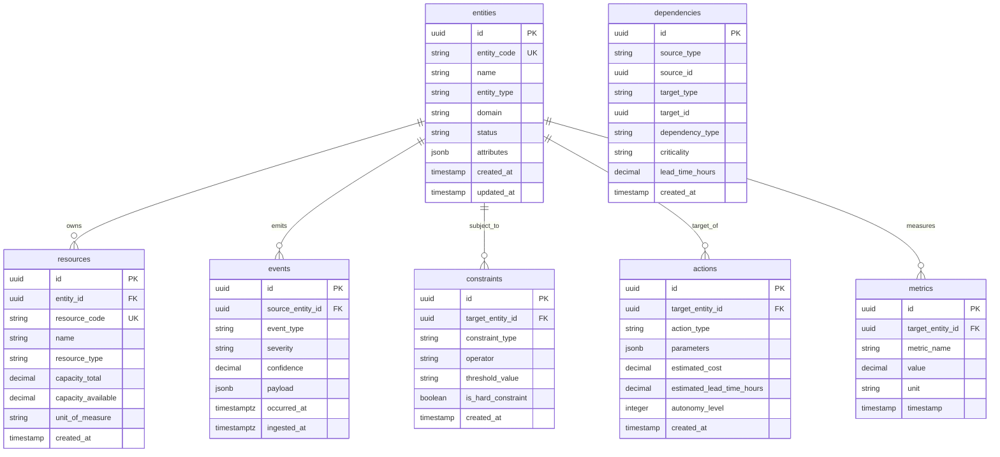
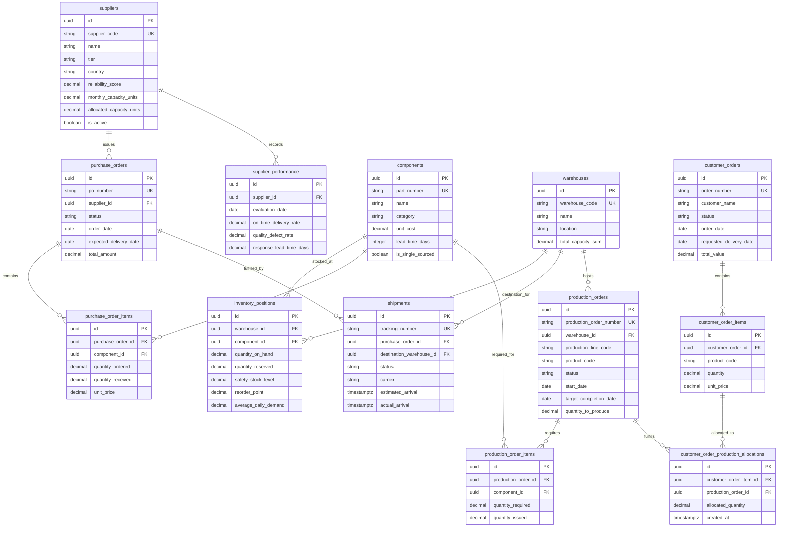

# Phase 2.0 Specification — Manufacturing Domain Model & Core Architecture Design (Revision 2)

## 1. Domain Architecture & Layering Model

The **NEXUS Platform** enforces a clean, modular architecture separating the domain-agnostic core from domain-specific operational data models. 

```
┌────────────────────────────────────────────────────────┐
│             NEXUS Core Engine (Domain Agnostic)        │
│  [Entity]  [Resource]  [Event]  [Constraint] [Action]  │
└───────────────────────────▲────────────────────────────┘
                            │ Domain Adapter Abstraction Layer
┌───────────────────────────┴────────────────────────────┐
│              Manufacturing Domain Adapter              │
│  - Entity Mapping & Graph Synchronization              │
│  - Derived Metrics & Dependency Resolution             │
└───────────────────────────▲────────────────────────────┘
                            │ Relational Data Persistence
┌───────────────────────────┴────────────────────────────┐
│            Manufacturing Operational Database          │
│  [Suppliers] [Components] [POs] [Shipments] [Orders]   │
└────────────────────────────────────────────────────────┘
```

### Architectural Principles:
1. **Domain Isolation**: Core modules interact exclusively with universal primitive models. They contain zero SQL queries referencing `suppliers` or `purchase_orders`.
2. **Adapter Mediation**: The **Manufacturing Domain Adapter** reads relational operational data and projects it into core `ENTITY`, `RESOURCE`, `CONSTRAINT`, and `DEPENDENCY` graph nodes.
3. **Database Integrity vs. Decision Logic**: Relational database schemas enforce structural data integrity (types, non-nulls, foreign keys, non-negative bounds). Operational business logic (e.g. recovery feasibility, supplier capacity allocation, alternative vendor ranking) resides strictly within service components.

---

## 2. Universal Core Primitive Model

The NEXUS Core persists graph topology and universal state in 7 core relational tables.



### Core Table Catalog

#### 1. `entities`
- **Purpose**: General registry for physical, organizational, or operational nodes in the NEXUS network.
- **Columns**:
  - `id` (UUID, Primary Key, Default: `gen_random_uuid()`)
  - `entity_code` (VARCHAR(64), Unique, Not Null) — e.g. `ENT-SUP-8821`
  - `name` (VARCHAR(255), Not Null)
  - `entity_type` (VARCHAR(64), Not Null) — e.g. `SUPPLIER`, `WAREHOUSE`, `PRODUCTION_LINE`
  - `domain` (VARCHAR(64), Not Null, Index) — e.g. `manufacturing`
  - `status` (VARCHAR(32), Not Null, Default: `'ACTIVE'`)
  - `attributes` (JSONB, Default: `'{}'`) — Key-value metadata
  - `created_at` (TIMESTAMPTZ, Default: `CURRENT_TIMESTAMP`)
  - `updated_at` (TIMESTAMPTZ, Default: `CURRENT_TIMESTAMP`)
- **Indexes**: `idx_entities_type_domain` (`entity_type`, `domain`), `idx_entities_code` (`entity_code`)

#### 2. `resources`
- **Purpose**: Capacity or stock position associated with an entity.
- **Columns**:
  - `id` (UUID, Primary Key)
  - `entity_id` (UUID, FK -> `entities.id` ON DELETE CASCADE, Not Null)
  - `resource_code` (VARCHAR(64), Unique, Not Null)
  - `name` (VARCHAR(255), Not Null)
  - `resource_type` (VARCHAR(64), Not Null) — e.g. `INVENTORY`, `CAPACITY`
  - `capacity_total` (NUMERIC(14,4), Not Null, CHECK `capacity_total >= 0`)
  - `capacity_available` (NUMERIC(14,4), Not Null, CHECK `capacity_available >= 0`)
  - `unit_of_measure` (VARCHAR(32), Not Null)
  - `created_at` (TIMESTAMPTZ, Default: `CURRENT_TIMESTAMP`)
- **Indexes**: `idx_resources_entity` (`entity_id`), `idx_resources_code` (`resource_code`)

#### 3. `events`
- **Purpose**: Telemetry and signal ingestion log distinguishing occurrence time from ingestion time for detection-latency analysis.
- **Columns**:
  - `id` (UUID, Primary Key)
  - `source_entity_id` (UUID, FK -> `entities.id`, Nullable)
  - `event_type` (VARCHAR(64), Not Null, Index)
  - `severity` (VARCHAR(32), Not Null)
  - `confidence` (NUMERIC(3,2), Not Null, Default: `1.00`, CHECK `confidence BETWEEN 0.00 AND 1.00`)
  - `payload` (JSONB, Default: `'{}'`)
  - `occurred_at` (TIMESTAMPTZ, Not Null, Index) — Timestamp when event occurred at physical/external source.
  - `ingested_at` (TIMESTAMPTZ, Default: `CURRENT_TIMESTAMP`, Index) — Timestamp when NEXUS ingested signal.
- **Indexes**: `idx_events_type_occurred` (`event_type`, `occurred_at`), `idx_events_ingested` (`ingested_at`)

#### 4. `constraints`
- **Purpose**: SLAs, policy limits, and boundary conditions enforced against entities.
- **Columns**: `id` (UUID, PK), `target_entity_id` (UUID, FK -> `entities.id`), `constraint_type` (VARCHAR(64)), `operator` (VARCHAR(16)), `threshold_value` (TEXT), `is_hard_constraint` (BOOLEAN).

#### 5. `actions`
- **Purpose**: Catalog of candidate or executed recovery interventions.
- **Columns**: `id` (UUID, PK), `target_entity_id` (UUID, FK -> `entities.id`), `action_type` (VARCHAR(64)), `parameters` (JSONB), `estimated_cost` (NUMERIC(12,2)), `estimated_lead_time_hours` (NUMERIC(8,2)), `autonomy_level` (INTEGER).

#### 6. `metrics`
- **Purpose**: Time-series health scores and calculated operational metrics.
- **Columns**: `id` (UUID, PK), `target_entity_id` (UUID, FK -> `entities.id`), `metric_name` (VARCHAR(64)), `value` (NUMERIC(14,4)), `unit` (VARCHAR(32)), `timestamp` (TIMESTAMPTZ).

#### 7. `dependencies` (Polymorphic Primitive Endpoints Design)
- **Purpose**: Directed relationship graph linking universal NEXUS primitives (`ENTITY`, `RESOURCE`, `EVENT`, `CONSTRAINT`, etc.).
- **Columns**:
  - `id` (UUID, Primary Key, Default: `gen_random_uuid()`)
  - `source_type` (VARCHAR(32), Not Null, Index) — e.g. `'ENTITY'`, `'RESOURCE'`
  - `source_id` (UUID, Not Null, Index) — ID of source primitive
  - `target_type` (VARCHAR(32), Not Null, Index) — e.g. `'ENTITY'`, `'RESOURCE'`
  - `target_id` (UUID, Not Null, Index) — ID of target primitive
  - `dependency_type` (VARCHAR(64), Not Null, Index) — e.g. `'REQUIRES_COMPONENT'`, `'FULFILLS_ORDER'`, `'STOCKED_AT'`
  - `criticality` (VARCHAR(32), Not Null, Default: `'MEDIUM'`) — e.g. `'LOW'`, `'MEDIUM'`, `'HIGH'`, `'CRITICAL'`
  - `lead_time_hours` (NUMERIC(8,2), Not Null, Default: `0.00`, CHECK `lead_time_hours >= 0`)
  - `created_at` (TIMESTAMPTZ, Default: `CURRENT_TIMESTAMP`)
- **Indexes**: `idx_dep_source` (`source_type`, `source_id`), `idx_dep_target` (`target_type`, `target_id`), `idx_dep_type` (`dependency_type`)

##### Dependency Model Trade-Off Analysis:
- **Design Choice**: Polymorphic Primitive Endpoints (`source_type`, `source_id`, `target_type`, `target_id`).
- **Trade-Offs**:
  - *Flexibility (Pro)*: Allows direct graph edges between any pair of primitives (e.g. `RESOURCE:Component` $\to$ `ENTITY:ProductionOrder`, `ENTITY:PurchaseOrder` $\to$ `RESOURCE:InventoryPosition`) without cluttering the schema with synthetic "wrapper" entities.
  - *Domain Neutrality (Pro)*: Core dependency graph logic operates uniformly across Manufacturing, Logistics, Aviation, and Energy domains.
  - *RDBMS Foreign Key Enforcement (Con)*: Relational databases cannot enforce strict foreign key constraints across multiple target tables simultaneously on a single polymorphic ID column without complex triggers or conditional rules.
  - *Mitigation*: Application adapters and database validation functions enforce referential existence checks prior to edge creation.

---

## 3. Manufacturing Domain Model Conceptual Mapping

To preserve domain neutrality, manufacturing domain objects map into core primitives as follows:

| Manufacturing Domain Term | Core Universal Primitive | Conceptual Mapping Justification |
| :--- | :--- | :--- |
| **Supplier** | `ENTITY` (`type: SUPPLIER`) | Physical vendor node supplying raw materials or components. |
| **Component** | `RESOURCE` (`type: INVENTORY_ITEM`) | Part, raw material, or sub-assembly used in manufacturing. |
| **Warehouse** | `ENTITY` (`type: WAREHOUSE`) | Physical storage location housing component inventory. |
| **Inventory Position** | `RESOURCE STATE` | Current on-hand and reserved quantity for a Component at a Warehouse. |
| **Purchase Order (PO)** | `ENTITY / OPERATIONAL RECORD` | Commercial contract binding a Supplier to deliver Components. |
| **Purchase Order Item** | `ENTITY ITEM` | Line-item detail specifying component, quantity, and unit cost. |
| **Shipment** | `ENTITY / OPERATIONAL RECORD` | Logistics movement delivering components under a Purchase Order. |
| **Production Order** | `ENTITY / OPERATIONAL RECORD` | Factory job execution run consuming components to assemble finished goods. |
| **Production Order Item** | `ENTITY ITEM` | Component requirements for a specific production run. |
| **Customer Order** | `ENTITY / OPERATIONAL RECORD` | Commercial customer demand contract. |
| **Customer Order Item** | `ENTITY ITEM` | Line-item demand specifying product quantity and unit price. |
| **Customer Order SLA** | `CONSTRAINT` | Delivery deadline and penalty clause attached to a Customer Order. |
| **Internal Policy** | `CONSTRAINT` | Governance limit (e.g. maximum auto-approved spend, preferred vendor list). |
| **Operational Dependency** | `DEPENDENCY` | Directed link (e.g. PO $\to$ Shipment, Shipment $\to$ Warehouse Stock, Stock $\to$ Production Run). |

> [!IMPORTANT]
> **Mapping Clarity Rules**:
> - Customer Order itself is **NOT** a Constraint; it is an Operational Record (`ENTITY`). The delivery deadline attached to it is the `CONSTRAINT`.
> - Purchase Order itself is **NOT** a Dependency; it is an Operational Record (`ENTITY`). The directional relationship binding Supplier delivery to Factory stock is the `DEPENDENCY`.

---

## 4. Manufacturing Domain Relational Database Catalog

The **Manufacturing Adapter** maintains 13 domain-specific tables in PostgreSQL:



---

### Comprehensive Manufacturing Schema Specifications

#### 1. `suppliers`
- **Purpose**: Vendor master data including explicit capacity limits for deterministic utilization analysis.
- **Fields**:
  - `id` (`UUID`, Primary Key, Default: `gen_random_uuid()`)
  - `supplier_code` (`VARCHAR(64)`, Unique, Not Null) — e.g. `SUP-8821`
  - `name` (`VARCHAR(255)`, Not Null)
  - `tier` (`VARCHAR(32)`, Not Null, Default: `'TIER_1'`)
  - `country` (`VARCHAR(3)`, Not Null) — ISO 3166-1 alpha-3 code (e.g. `TWN`, `DEU`, `USA`)
  - `reliability_score` (`NUMERIC(3,2)`, Not Null, Default: `1.00`, CHECK `reliability_score BETWEEN 0.00 AND 1.00`)
  - `monthly_capacity_units` (`NUMERIC(14,4)`, Not Null, Default: `10000.0000`, CHECK `monthly_capacity_units > 0`)
  - `allocated_capacity_units` (`NUMERIC(14,4)`, Not Null, Default: `0.0000`, CHECK `allocated_capacity_units >= 0`)
  - `is_active` (`BOOLEAN`, Not Null, Default: `TRUE`)
  - `created_at` (`TIMESTAMPTZ`, Default: `CURRENT_TIMESTAMP`)
- **Constraints**: Check Constraint `chk_supplier_capacity_allocated` (`allocated_capacity_units <= monthly_capacity_units`)
- **Indexes**: `idx_suppliers_code` (`supplier_code`), `idx_suppliers_active` (`is_active`)

#### 2. `components`
- **Purpose**: Master catalog of raw materials, parts, and assemblies.
- **Fields**: `id` (`UUID`, PK), `part_number` (`VARCHAR(64)`, UK), `name` (`VARCHAR(255)`), `category` (`VARCHAR(64)`), `unit_cost` (`NUMERIC(12,4)`, CHECK `>= 0`), `lead_time_days` (`INTEGER`, CHECK `>= 0`), `is_single_sourced` (`BOOLEAN`), `created_at` (`TIMESTAMPTZ`).

#### 3. `warehouses`
- **Purpose**: Physical storage and production facilities.
- **Fields**: `id` (`UUID`, PK), `warehouse_code` (`VARCHAR(64)`, UK), `name` (`VARCHAR(255)`), `location` (`VARCHAR(255)`), `total_capacity_sqm` (`NUMERIC(10,2)`, CHECK `> 0`), `created_at` (`TIMESTAMPTZ`).

#### 4. `inventory_positions`
- **Purpose**: Stock levels and deterministic daily demand for time-to-stockout calculations.
- **Fields**:
  - `id` (`UUID`, Primary Key)
  - `warehouse_id` (`UUID`, FK -> `warehouses.id` ON DELETE CASCADE, Not Null)
  - `component_id` (`UUID`, FK -> `components.id` ON DELETE CASCADE, Not Null)
  - `quantity_on_hand` (`NUMERIC(14,4)`, Not Null, Default: `0.0000`, CHECK `quantity_on_hand >= 0`)
  - `quantity_reserved` (`NUMERIC(14,4)`, Not Null, Default: `0.0000`, CHECK `quantity_reserved >= 0`)
  - `safety_stock_level` (`NUMERIC(14,4)`, Not Null, Default: `0.0000`, CHECK `safety_stock_level >= 0`)
  - `reorder_point` (`NUMERIC(14,4)`, Not Null, Default: `0.0000`, CHECK `reorder_point >= 0`)
  - `average_daily_demand` (`NUMERIC(14,4)`, Not Null, Default: `0.0000`, CHECK `average_daily_demand >= 0`)
  - `created_at` (`TIMESTAMPTZ`, Default: `CURRENT_TIMESTAMP`)
  - `updated_at` (`TIMESTAMPTZ`, Default: `CURRENT_TIMESTAMP`)
- **Constraints**:
  - Unique Constraint: `uq_inventory_warehouse_component` (`warehouse_id`, `component_id`)
  - Check Constraint: `chk_reserved_le_on_hand` (`quantity_reserved <= quantity_on_hand`)
- **Demand Metric Note**: In future operational phases, `average_daily_demand` may be dynamically derived from historical consumption event streams, but Phase 2 seed data provides static deterministic baseline demand.

#### 5. `purchase_orders`
- **Purpose**: Header record for supplier procurement orders.
- **Fields**: `id` (`UUID`, PK), `po_number` (`VARCHAR(64)`, UK), `supplier_id` (`UUID`, FK -> `suppliers.id`), `status` (`VARCHAR(32)`), `order_date` (`DATE`), `expected_delivery_date` (`DATE`), `total_amount` (`NUMERIC(14,2)`), `created_at` (`TIMESTAMPTZ`).
- **Constraints**: `chk_po_delivery_after_order` (`expected_delivery_date >= order_date`)

#### 6. `purchase_order_items`
- **Purpose**: Line items for purchase orders.
- **Fields**: `id` (`UUID`, PK), `purchase_order_id` (`UUID`, FK -> `purchase_orders.id`), `component_id` (`UUID`, FK -> `components.id`), `quantity_ordered` (`NUMERIC(14,4)`), `quantity_received` (`NUMERIC(14,4)`), `unit_price` (`NUMERIC(12,4)`).
- **Constraints**: `chk_po_item_received_le_ordered` (`quantity_received <= quantity_ordered`)

#### 7. `shipments`
- **Purpose**: Tracks freight movement fulfilling purchase orders.
- **Fields**: `id` (`UUID`, PK), `tracking_number` (`VARCHAR(64)`, UK), `purchase_order_id` (`UUID`, FK -> `purchase_orders.id`), `destination_warehouse_id` (`UUID`, FK -> `warehouses.id`), `status` (`VARCHAR(32)`), `carrier` (`VARCHAR(128)`), `estimated_arrival` (`TIMESTAMPTZ`), `actual_arrival` (`TIMESTAMPTZ`).

#### 8. `production_orders` (Enhanced Plant/Line Capacity Traceability)
- **Purpose**: Factory assembly work orders explicitly mapped to facility, line, and product.
- **Fields**:
  - `id` (`UUID`, Primary Key)
  - `production_order_number` (`VARCHAR(64)`, Unique, Not Null) — e.g. `PRD-2026-0044`
  - `warehouse_id` (`UUID`, FK -> `warehouses.id` ON DELETE RESTRICT, Not Null) — Host facility
  - `production_line_code` (`VARCHAR(64)`, Not Null, Index) — e.g. `LINE-SMT-01`
  - `product_code` (`VARCHAR(64)`, Not Null, Index) — e.g. `PRD-EV-BATTERY`
  - `status` (`VARCHAR(32)`, Not Null, Default: `'PLANNED'`)
  - `start_date` (`DATE`, Not Null)
  - `target_completion_date` (`DATE`, Not Null)
  - `quantity_to_produce` (`NUMERIC(14,4)`, Not Null, CHECK `quantity_to_produce > 0`)
  - `created_at` (`TIMESTAMPTZ`, Default: `CURRENT_TIMESTAMP`)
- **Constraints**: `chk_prod_order_dates` (`target_completion_date >= start_date`)
- **Indexes**: `idx_prod_order_line` (`warehouse_id`, `production_line_code`), `idx_prod_order_product` (`product_code`)

#### 9. `production_order_items`
- **Purpose**: Component requirements per production work order.
- **Fields**: `id` (`UUID`, PK), `production_order_id` (`UUID`, FK -> `production_orders.id`), `component_id` (`UUID`, FK -> `components.id`), `quantity_required` (`NUMERIC(14,4)`), `quantity_issued` (`NUMERIC(14,4)`).

#### 10. `customer_orders`
- **Purpose**: Commercial customer demand contracts.
- **Fields**: `id` (`UUID`, PK), `order_number` (`VARCHAR(64)`, UK), `customer_name` (`VARCHAR(255)`), `status` (`VARCHAR(32)`), `order_date` (`DATE`), `requested_delivery_date` (`DATE`), `total_value` (`NUMERIC(14,2)`).
- **Constraints**: `chk_cust_order_dates` (`requested_delivery_date >= order_date`)

#### 11. `customer_order_items`
- **Purpose**: Line items for customer orders.
- **Fields**: `id` (`UUID`, PK), `customer_order_id` (`UUID`, FK -> `customer_orders.id`), `product_code` (`VARCHAR(64)`), `quantity` (`NUMERIC(14,4)`), `unit_price` (`NUMERIC(12,4)`).

#### 12. `customer_order_production_allocations` (Normalized Traceability)
- **Purpose**: Normalized allocation join table mapping customer order items to one or more production orders.
- **Fields**:
  - `id` (`UUID`, Primary Key, Default: `gen_random_uuid()`)
  - `customer_order_item_id` (`UUID`, FK -> `customer_order_items.id` ON DELETE CASCADE, Not Null)
  - `production_order_id` (`UUID`, FK -> `production_orders.id` ON DELETE RESTRICT, Not Null)
  - `allocated_quantity` (`NUMERIC(14,4)`, Not Null, CHECK `allocated_quantity > 0`)
  - `created_at` (`TIMESTAMPTZ`, Default: `CURRENT_TIMESTAMP`)
- **Indexes**: `idx_alloc_cust_item` (`customer_order_item_id`), `idx_alloc_prod_order` (`production_order_id`)

#### 13. `supplier_performance`
- **Purpose**: Historical compliance telemetry per supplier.
- **Fields**: `id` (`UUID`, PK), `supplier_id` (`UUID`, FK -> `suppliers.id`), `evaluation_date` (`DATE`), `on_time_delivery_rate` (`NUMERIC(3,2)`), `quality_defect_rate` (`NUMERIC(3,2)`), `response_lead_time_days` (`NUMERIC(6,2)`).

---

## 5. Separation of Database Integrity vs. Operational Business Logic

To prevent coupling database schemas to future decision engine implementations, NEXUS strictly delineates database constraints from service-level business rules:

```
┌────────────────────────────────────────────────────────┐
│             Database Schema Level (SQL CHECKs)         │
│  - Structural Integrity & Data Types                   │
│  - Non-Negative Bounds (qty >= 0, cost >= 0)           │
│  - Foreign Key Constraints & Unique Indexes            │
│  - Date Sanity (delivery_date >= order_date)           │
│  - Reserved Stock Boundary (reserved <= on_hand)       │
│  - Supplier Capacity Boundary (allocated <= monthly)   │
└───────────────────────────▲────────────────────────────┘
                            │ Enforced by RDBMS
┌───────────────────────────┴────────────────────────────┐
│            Application / Service Layer                 │
│  - Supplier Capacity Allocation & Feasibility          │
│  - Alternative Supplier Selection & Ranking            │
│  - Production Job Rescheduling & Prioritization        │
│  - Recovery Plan Optimization & Trade-Off Evaluation   │
└────────────────────────────────────────────────────────┘
```

| Domain Rule | Enforcement Layer | Technical Mechanism | Rationale |
| :--- | :--- | :--- | :--- |
| **Non-negative Quantities** | Database | `CHECK (quantity >= 0)` | Prevents corrupted negative inventory database records. |
| **Non-negative Unit Costs** | Database | `CHECK (unit_cost >= 0)` | Prevents invalid financial calculations. |
| **Reserved Stock $\le$ On-Hand Stock** | Database | `CHECK (quantity_reserved <= quantity_on_hand)` | Physical impossibility guardrail in inventory position. |
| **Supplier Allocated $\le$ Monthly Capacity** | Database | `CHECK (allocated <= monthly)` | Prevents over-booking raw supplier capacity. |
| **Delivery Date $\ge$ Order Date** | Database | `CHECK (delivery_date >= order_date)` | Temporal sanity constraint. |
| **Foreign Key Reference** | Database | `FOREIGN KEY ... REFERENCES` | Prevents orphan records. |
| **Available Inventory Derivation** | Service / Model View | `quantity_on_hand - quantity_reserved` | Deterministically calculated in code/queries without redundant column storage. |
| **Supplier Utilization Derivation** | Service / Model View | `(allocated / monthly) * 100` | Deterministically derived from capacity columns. |
| **Shipment Qty $\le$ PO Outstanding** | Service Layer | Application Validator | Dynamic business check depending on partial fulfillment state across shipments. |
| **Recovery Feasibility & Prioritization** | Service Layer | Scenario Simulator | Dynamic discrete-event simulation rule. |

---

## 6. State Machine & Lifecycle Definitions

State transitions for primary operational entities are strictly defined via string Enums and enforced in application service wrappers:

### 1. Purchase Order Lifecycle (`PurchaseOrderStatus`)
```
[DRAFT] ──► [ISSUED] ──► [CONFIRMED] ──► [PARTIALLY_FULFILLED] ──► [FULFILLED]
   │           │            │
   └──► [CANCELLED] ◄───────┴──────────────────────────────────────────┘
```

### 2. Shipment Lifecycle (`ShipmentStatus`)
```
[SCHEDULED] ──► [DISPATCHED] ──► [IN_TRANSIT] ──► [DELIVERED]
                   │                │
                   └──► [DELAYED] ◄─┘
                           │
                           └──► [EXCEPTION]
```

### 3. Production Order Lifecycle (`ProductionOrderStatus`)
```
[PLANNED] ──► [SCHEDULED] ──► [IN_PROGRESS] ──► [COMPLETED]
   │             │                 │
   └─────► [CANCELLED] ◄──── [ON_HOLD]
```

### 4. Customer Order Lifecycle (`CustomerOrderStatus`)
```
[RECEIVED] ──► [APPROVED] ──► [SCHEDULED] ──► [IN_PRODUCTION] ──► [SHIPPED] ──► [DELIVERED]
    │             │              │
    └──────► [CANCELLED] ◄───────┘
```

---

## 7. Seed Dataset & Vulnerability Strategy

### Target Dataset Volumes
- **Suppliers**: 12 active vendors across Taiwan, Germany, USA, Japan, and Vietnam.
- **Components**: 35 SKUs.
- **Warehouses**: 4 regional hubs.
- **Inventory Positions**: 140 warehouse-component pairs with `average_daily_demand` values.
- **Purchase Orders**: 75 POs across fulfillment stages.
- **Shipments**: 60 active and historical shipments.
- **Production Orders**: 40 factory assembly runs mapped to facility and line codes.
- **Customer Orders**: 100 sales contracts with normalized allocations to production orders.

### 7 Intentional Supply Chain Vulnerabilities (Chaos Seed Targets)
1. **VULN-01: Single-Source Critical Component**: `MCU-v4-CRITICAL` sourced exclusively from `Acme Microelectronics Inc.`
2. **VULN-02: Unreliable Tier-1 Supplier**: Supplier `Global Logistics Freight Co.` has `reliability_score` of `0.65` and `35%` delay rate.
3. **VULN-03: Low Safety Stock Inventory**: `WH-PLANT-01` holds `1.5 days` of stock for `CAP-CER-100uF`.
4. **VULN-04: In-Transit Delayed Freight Shipment**: Shipment `TRK-OCEAN-99` carrying `PWR-IC-5V` is `DELAYED` (+96 hours).
5. **VULN-05: Strict Customer SLA with High Financial Penalty**: Customer Order `SO-CUST-ULTRA` carries $\$10,000/\text{day}$ penalty.
6. **VULN-06: Supplier Operating Near Capacity Ceiling**: Supplier `Bavaria Precision` has `allocated_capacity_units = 980` against `monthly_capacity_units = 1000` (98% utilization).
7. **VULN-07: Non-Substitutable Custom Assembly**: Production Order `PRD-EV-BATTERY` requires custom housing `HSG-ALU-CUSTOM`.

---

## 8. Read-Only API Contract Specification

Phase 2 defines **10 read-only REST API resource groups** (with collection and detail routes) exposed by FastAPI:

1. **Suppliers**: `GET /api/v1/suppliers` & `GET /api/v1/suppliers/{id}`
2. **Components**: `GET /api/v1/components` & `GET /api/v1/components/{id}`
3. **Warehouses**: `GET /api/v1/warehouses` & `GET /api/v1/warehouses/{id}`
4. **Inventory**: `GET /api/v1/inventory` & `GET /api/v1/inventory/{id}`
5. **Purchase Orders**: `GET /api/v1/purchase-orders` & `GET /api/v1/purchase-orders/{id}`
6. **Purchase Order Items**: `GET /api/v1/purchase-orders/{id}/items`
7. **Shipments**: `GET /api/v1/shipments` & `GET /api/v1/shipments/{id}`
8. **Production Orders**: `GET /api/v1/production-orders` & `GET /api/v1/production-orders/{id}`
9. **Customer Orders**: `GET /api/v1/customer-orders` & `GET /api/v1/customer-orders/{id}`
10. **Dependencies**: `GET /api/v1/dependencies` & `GET /api/v1/dependencies/{id}`

---

## 9. Domain Adapter Boundaries & Mapping Mechanism

The **Manufacturing Domain Adapter** translates relational tables into Core primitive graphs dynamically:

```python
# Conceptual Adapter Function (Documentation Only)
def map_supplier_to_core_entity(supplier: SupplierModel) -> EntityPrimitive:
    return EntityPrimitive(
        id=supplier.id,
        entity_code=supplier.supplier_code,
        name=supplier.name,
        entity_type="SUPPLIER",
        domain="manufacturing",
        status="ACTIVE" if supplier.is_active else "INACTIVE",
        attributes={
            "tier": supplier.tier,
            "country": supplier.country,
            "reliability_score": float(supplier.reliability_score),
            "monthly_capacity_units": float(supplier.monthly_capacity_units),
            "allocated_capacity_units": float(supplier.allocated_capacity_units),
        }
    )
```

---

## 10. Migration & Alembic Strategy (Documentation Only)

> [!NOTE]
> Alembic installation and configuration are deferred to Phase 2.1 implementation.

---

## 11. Testing Strategy

When Phase 2.1 implementation starts, tests will cover schema validation, DB check constraints, FK rules, and adapter graph projections.

---

## 12. Architectural Review & ADR Evaluation

### Review Against Existing Documents:
- **`AGENTS.md`**: Fully compliant. Domain models are scoped strictly inside `domain_adapters/manufacturing/`; Core remains domain-agnostic.
- **`docs/ARCHITECTURE.md`**: Fully compliant. Preserves control loop and 23 components.
- **`docs/DOMAIN_MODEL.md`**: Fully compliant. Implements the 7 core primitives.

### Proposed Architectural Decision Records (ADRs)

```markdown
# ADR-008: Formal Separation of Database Integrity Constraints from Operational Business Logic
* **Status**: PROPOSED
* **Decision**: Relational database schemas enforce structural data integrity (types, non-nulls, FKs, non-negative bounds, date sanity). Operational business logic (capacity allocation, recovery feasibility, alternative vendor selection) will be implemented exclusively within application service layers.

# ADR-009: Polymorphic Universal Primitive Dependency Linking Protocol
* **Status**: PROPOSED
* **Decision**: The core `dependencies` table uses polymorphic endpoints (`source_type`, `source_id`, `target_type`, `target_id`) to allow direct directed edges between any pair of NEXUS primitives (`ENTITY`, `RESOURCE`, etc.) without creating synthetic entity wrappers.

# ADR-010: Explicit Capacity and Demand Metrics for Deterministic Disruption Analysis
* **Status**: PROPOSED
* **Decision**: Explicit numerical capacities (`monthly_capacity_units`, `allocated_capacity_units`) and baseline demand metrics (`average_daily_demand`) must be stored as underlying numeric fields rather than unexplained magic utilization percentages.
```

---

## 13. Strict Stop Condition Summary

Phase 2.0 design review document `docs/PHASE_2_DOMAIN_DESIGN.md` (Revision 2) has been updated. Zero code, database models, Alembic migrations, APIs, or seed scripts were executed or created. Existing Phase 0 and Phase 1 code remains frozen.
