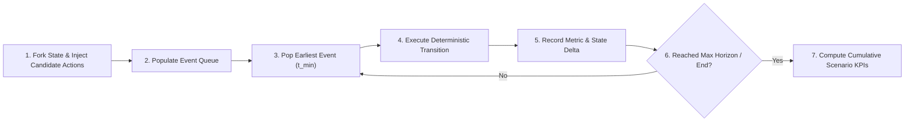

# Scenario Simulation & Digital Twin Specification

## 1. Digital Twin Architecture & State Representations

The NEXUS **Digital Twin** maintains an in-memory, graph-based representation of the physical operational network. To enable safety and counterfactual reasoning, the Digital Twin categorizes state into three distinct tiers:

```
┌────────────────────────────────────────────────────────┐
│                   CURRENT STATE (T_0)                  │
│       Real-time operational truth mirrored from ERP    │
└───────────────────────────┬────────────────────────────┘
                            │
            ┌───────────────┴───────────────┐
            ▼                               ▼
┌───────────────────────┐       ┌───────────────────────┐
│ PROJECTED STATE (T+N) │       │ SCENARIO STATE (T+N') │
│ Baseline propagation  │       │ Candidate recovery    │
│ (No Intervention)     │       │ plan fork (Simulated) │
└───────────────────────┘       └───────────────────────┘
```

### State Definitions

1. **CURRENT STATE ($S_{curr}$)**:
   - Represents the live, verified operational state at timestamp $T_0$.
   - Synchronized continuously via incoming events, ERP signals, and telemetry feeds.
   - Read-only baseline for all simulation forks.

2. **PROJECTED STATE ($S_{proj}$)**:
   - Represents the future operational state trajectory ($T_0 \to T_{max}$) assuming **no interventions** are executed.
   - Projects unmitigated stockouts, production line halts, SLA defaults, and financial exposure.

3. **SCENARIO STATE ($S_{scen}$)**:
   - Represents an isolated counterfactual state fork derived by applying a specific **Candidate Recovery Strategy** to $S_{curr}$.
   - Evaluates how system metrics behave over simulated time ($T_0 \to T_{max}$) under proposed actions.

---

## 2. State Cloning & Delta Tracking Mechanics

To ensure high performance and low memory overhead during simulation, the Digital Twin uses **Copy-on-Write (CoW) State Cloning** and **Delta Graph Branching**.

```
Base Digital Twin State (Current State @ T_0)
  ├── Root Nodes: [Entities, Resources, Dependencies]
  │
  ├── Fork A (Scenario: Air Freight Component Backup)
  │     └── Delta: { RES-INV-10492: +500 units @ T+24h, COST: +$4,500 }
  │
  └── Fork B (Scenario: Re-route Production Line B)
        └── Delta: { PROD-LINE-02: Assigned PO-902 @ T+6h, CAPACITY: -20% }
```

### Cloning Protocol
1. **Instantiation**: When a simulation starts, the engine creates a virtual branch referencing $S_{curr}$ read-only nodes.
2. **Delta Buffer**: Any state modification generated by simulated time-step events is written exclusively to the scenario's local `DeltaBuffer`.
3. **Lookup Resolution**: Node queries evaluate `DeltaBuffer` first; if no local modification exists, query resolves to the baseline $S_{curr}$ value.
4. **Disposal**: Once simulation finishes, the scenario fork can be instantly discarded without mutating $S_{curr}$.

---

## 3. Deterministic Discrete-Event Simulation Engine

The Scenario Simulator models time evolution using a **Deterministic Discrete-Event Simulation (DES)** loop.



### Reproducibility & Random Seed Enforcement
1. **Zero Nondeterministic Calls**: System time calls (`time.now()`), thread scheduling, and unseeded random distributions are strictly forbidden inside simulation loops.
2. **Mandatory Random Seed**: Every simulation invocation requires an explicit integer seed parameter (`seed: int`).
3. **Stochastic Distortions**: Stochastic elements (e.g., historical transit delay distributions) must use pseudo-random generators initialized strictly with the scenario seed.

---

## 4. Counterfactual Simulation Schema Specification

```json
{
  "simulation_request": {
    "scenario_id": "SIM-SCEN-20260822-001",
    "seed": 42,
    "time_horizon_hours": 168,
    "time_step_hours": 1,
    "candidate_strategy": {
      "strategy_name": "Expedite Air Freight Backup",
      "proposed_actions": [
        {
          "action_type": "CREATE_PURCHASE_ORDER",
          "target_supplier_id": "ENT-SUP-9910",
          "component_id": "RES-INV-10492",
          "quantity": 500,
          "scheduled_dispatch_hour": 6,
          "estimated_transit_hours": 24
        }
      ]
    }
  },
  "simulation_result": {
    "scenario_id": "SIM-SCEN-20260822-001",
    "execution_status": "COMPLETED",
    "outcomes": {
      "production_downtime_hours": 0.0,
      "total_cost_usd": 4500.00,
      "breached_customer_slas": 0,
      "residual_risk_score": 0.12,
      "time_to_recovery_hours": 30.0
    },
    "metric_trajectories": [
      { "hour": 0, "inventory_level": 120, "production_status": "RUNNING" },
      { "hour": 24, "inventory_level": 10, "production_status": "CRITICAL" },
      { "hour": 30, "inventory_level": 510, "production_status": "REPLENISHED" }
    ]
  }
}
```
